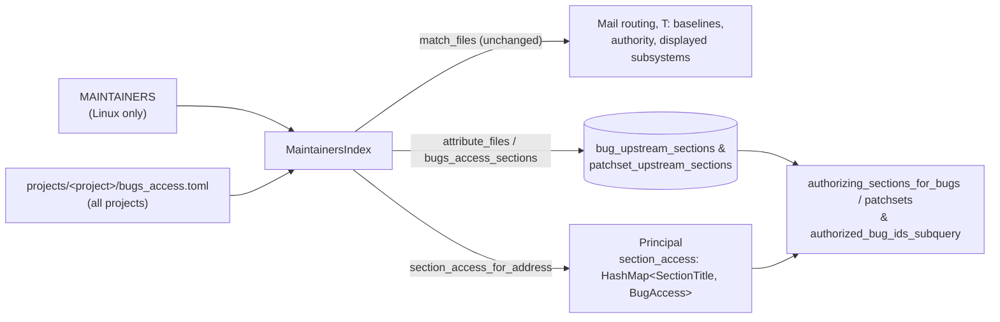

# Design: Fine-Grained Subsystem Bug and Embargo Access (`bugs_access.toml`)

## Status

Accepted. Supersedes
[`DESIGN_UPSTREAM_MAINTAINER_BUG_ACCESS.md`](DESIGN_UPSTREAM_MAINTAINER_BUG_ACCESS.md)
(#787) and addresses GitHub issue #867 ("More fine grained Bugs access").

## 1. Problem

Under [`DESIGN_BUG_ACCESS_CONTROL.md`](DESIGN_BUG_ACCESS_CONTROL.md) and
[`DESIGN_UPSTREAM_MAINTAINER_BUG_ACCESS.md`](DESIGN_UPSTREAM_MAINTAINER_BUG_ACCESS.md),
subsystem-scoped bug and embargo authority is derived from kernel `MAINTAINERS`
sections plus path-only extensions in `projects/linux/upstream_maintainers.toml`:

1. **No per-subsystem read vs. read-write developer grants (#867):** Subsystems
   with active developer groups (such as `linux-btrfs`) have contributors who
   help triage and fix functional bugs but are not listed on `M:` or `R:` lines
   in `MAINTAINERS` (adding them as `R:` upstream would copy them on every patch
   via `scripts/get_maintainer.pl`). Today those developers cannot sign in, see
   the subsystem's **Bugs** tab (`GET /api/bugs`), or receive read-only access;
   maintainers have to copy individual `<project>-<uuid>` capability links one
   bug at a time.
2. **No access-control overrides over `MAINTAINERS`:** There is no way to
   exclude an inactive or role-account `M:`/`R:` address from bug access on one
   section without globally blocklisting them in `[server.acl].blocklist`, to
   replace a section's access list, or to narrow/replace an overly broad
   section's file patterns for access control without changing upstream
   `MAINTAINERS`.
3. **No subsystem-scoped bug access on non-Linux projects:** Projects without a
   kernel `MAINTAINERS` file (`sashiko`, `gcc`, `qemu`, `zephyr`) have no way to
   grant path-scoped bug or embargo access outside global `[server.acl]` lists.

## 2. Goals

1. Rename `projects/linux/upstream_maintainers.toml` to
   `projects/<project>/bugs_access.toml` and load it for **all** projects
   (`linux`, `sashiko`, `gcc`, `qemu`, `zephyr`), falling back to a legacy
   `projects/linux/upstream_maintainers.toml` on disk with a deprecation warning
   when `bugs_access.toml` is absent.
2. Support **extending and overriding** `MAINTAINERS` strictly for Sashiko
   access control (bugs, embargoed patchset reviews, review transcripts, and
   sign-in eligibility) with separate `read` and `read_write` (`"read-write"`)
   options:
   - **Emails (`read` & `read_write`):** grant read-only access (`read = [...]`)
     and/or full maintainer read-write access (`read_write = [...]`, alias
     `"read-write"`), exclude specific `MAINTAINERS` emails (`exclude_emails`),
     or replace a section's `MAINTAINERS` email list (`replace_emails = true`).
   - **Paths:** add extra `F:`-style `paths` (preserving #787, with optional
     `access = "read" | "read_write"` when granting existing section maintainers
     read-only vs. read-write visibility over extra paths), exclude subtrees
     (`exclude_paths`), or replace a section's `MAINTAINERS` paths
     (`replace_paths = true`).
   - **Custom / standalone grants:** define access sections with `paths` plus
     `read` and/or `read_write` (with an optional custom `section` title) on
     both Linux and non-`MAINTAINERS` projects.
3. Preserve strict separation between **access control** and **ownership**:
   outbound email routing, `T:` baseline tree selection, contributor authority,
   LLM maintainer hints, similarity subsystem matching, and subsystem names
   displayed on bugs and patchsets continue to follow `MAINTAINERS` (and path
   prefixes where `MAINTAINERS` is absent) unchanged.
4. Require **zero SQLite schema migrations**, zero database walks when only
   email grants (`read`, `read_write`, `exclude_emails`, `replace_emails`)
   change, and retroactive startup reconciliation whenever path rules change.

## 3. Non-Goals

- Per-bug public/private state toggles (`BugAction` remains unchanged; single-bug
  sharing continues to use `<project>-<uuid>` capability URLs).
- Changing `[server.acl]` global roles (`admins`, `security`, `bug_reporters`,
  `blocklist`); `[server.acl].blocklist` continues to override every grant.

---

## 4. Configuration Schema (`projects/<project>/bugs_access.toml`)

Each entry is a `[[grant]]` table parsed with `#[serde(deny_unknown_fields)]`:

```toml
# 1. Upstream pull-request receivers (#787): widen paths for an existing
#    MAINTAINERS section's M:/R: maintainers (defaults to read-write; set
#    `access = "read"` for read-only visibility over the extra paths).
[[grant]]
section = "ARM AND ARM64 SoC SUB-ARCHITECTURES (COMMON PARTS)"
paths = ["arch/*/boot/dts/", "drivers/soc/", "drivers/firmware/"]

# 2. Subsystem developer group (#867): grant separate `read` (read-only) and
#    `read_write` (or `"read-write"`, full maintainer) access on a section.
[[grant]]
section = "BTRFS FILE SYSTEM"
read = ["dev1@example.org", "Developer Two <dev2@example.org>"]
read_write = ["co-maintainer@example.org"]

# 3. Standalone / custom section grant (works on Linux and non-Linux projects):
[[grant]]
section = "BTRFS ZONED" # optional when `paths` + (`read` or `read_write`) are given
paths = ["fs/btrfs/zoned.*"]
exclude_paths = ["fs/btrfs/tests/"]
read = ["zoned-reader@example.org"]
read_write = ["zoned-lead@example.org"]

# 4. Overriding an existing MAINTAINERS section's emails or paths:
[[grant]]
section = "LEGACY SUBSYSTEM"
replace_emails = true
read_write = ["active-maintainer@example.org"]
read = ["triage-dev@example.org"]
exclude_paths = ["drivers/legacy/unmaintained/"]
```

### 4.1 Fields

| Key | Type | Default | Meaning |
| --- | --- | --- | --- |
| `section` | optional string | `None` | Existing `MAINTAINERS` section title (matched case- and whitespace-insensitively) or a custom section title. Optional when `paths` and at least one of `read` / `read_write` are non-empty. |
| `paths` | list of strings | `[]` | `MAINTAINERS` `F:`-style file patterns to include. |
| `exclude_paths` | list of strings | `[]` | `MAINTAINERS` `X:`-style file patterns to exclude (takes precedence over `paths` and inherited `F:`/`N:` patterns). |
| `replace_paths` | bool | `false` | Discard inherited `MAINTAINERS` `F:`/`X:`/`N:` patterns for `section` and match only `paths` minus `exclude_paths`. |
| `read` | list of strings | `[]` | Bare addresses (`user@domain`) or `Name <user@domain>` entries granted read-only access (`BugAccess::Read`). |
| `read_write` (alias `"read-write"`) | list of strings | `[]` | Addresses granted full maintainer read-write access (`BugAccess::Manage`). |
| `exclude_emails` | list of strings | `[]` | Addresses removed from `section`'s access map before `read` and `read_write` apply. |
| `replace_emails` | bool | `false` | Clear inherited `MAINTAINERS` `M:`/`R:` addresses for `section` before applying `read` and `read_write`. |
| `access` | optional `"read"` \| `"read_write"` (`"read-write"`) | `None` (`"read_write"`) | Access level granted to `section`'s existing `M:`/`R:` maintainers on a path-only grant (`read` and `read_write` both empty). |

### 4.2 Validation Rules (Fail-Closed)

A parse error in `bugs_access.toml` logs an error and loads zero grants (failing
closed). Each `[[grant]]` is validated statically (`bugs_access::validate_grant`,
also enforced in CI over every `projects/*/bugs_access.toml`) and against the
loaded `MaintainersIndex`:

1. **Pattern hygiene:** Every entry in `paths` and `exclude_paths` must be
   non-empty, free of control characters, and must not cover the whole tree
   (`*`, `*/`, `**`, `*/*`).
2. **Email hygiene:** Every entry in `read`, `read_write`, and `exclude_emails`
   must parse via `maintainer_address`.
3. **Section hygiene:** When `section` is present, it must be non-empty after
   trimming, contain no control characters, and not start with the reserved
   internal prefix `bugs_access::`. Targeting a catch-all `MAINTAINERS` section
   (`THE REST`) is rejected.
4. **Structural completeness:**
   - Setting `access` alongside non-empty `read` or `read_write` is rejected
     (use `read` and `read_write` directly for explicit email lists; `access` is
     only for path grants to an existing `MAINTAINERS` section).
   - When `section` is omitted: `paths` must be non-empty, at least one of
     `read` or `read_write` must be non-empty, and `replace_paths`,
     `replace_emails`, `exclude_emails`, and `access` must not be set.
   - When `section` is set: at least one of `paths`, `exclude_paths`,
     `replace_paths`, `read`, `read_write`, `exclude_emails`, or `replace_emails`
     must be non-empty / `true`; `replace_paths = true` requires non-empty
     `paths`.
5. **No ambiguous path + email widening on existing `MAINTAINERS` sections:**
   If `section` matches an existing `MAINTAINERS` section and a single `[[grant]]`
   sets both `paths` (with `replace_paths = false`) and `read`/`read_write`
   (with `replace_emails = false`), the grant is rejected with an actionable
   error. Authors either omit `section` (or name a custom section) for a narrow
   grant, split path widening and section membership into two `[[grant]]`
   blocks, or set `replace_paths = true` when intentionally redefining the
   section.
6. **Typo protection against missing `MAINTAINERS` sections:** If `section` is
   not in `MAINTAINERS`, the folded rules for `section` must supply both
   non-empty `paths` and at least one address in `read` or `read_write`. A typo
   in an existing section title on a paths-only (#787) or emails-only (#867)
   grant therefore fails validation and is dropped with an error rather than
   creating a dead custom section.

---

## 5. Architecture



### 5.1 Authorization Key Separation for Overridden and Custom Sections

`bug_subsystems` (`source = 'maintainers_section'`) and
`patchset_maintainer_sections` store raw `MAINTAINERS` matches and also power
subsystem display and `GROUP BY bs.subsystem` counts in the Web UI.

If `bugs_access.toml` narrows an existing `MAINTAINERS` section `S` via
`replace_paths = true` or `exclude_paths`, raw rows `(bug_id, S, 'maintainers_section')`
in `bug_subsystems` must **not** continue granting access to excluded files:

- **Unmodified or `read_write` path-extended `MAINTAINERS` section `S`**
  (`!replace_paths && exclude_paths.is_empty()`):
  - Authorization key: `S` (verbatim `MAINTAINERS` title).
  - Inherited `F:`/`N:` matches come from `bug_subsystems` /
    `patchset_maintainer_sections`; any `read_write` extra `paths` are written
    to `bug_upstream_sections` / `patchset_upstream_sections` under `S` (and any
    `access = "read"` extra `paths` use `bugs_access::path_read:<S>` mapped to
    `AccessLevel::Read` for `S`'s maintainers).
  - When `paths` is empty (pure `read` / `read_write` email grant such as #867),
    **zero** rows are needed in `bug_upstream_sections` or
    `patchset_upstream_sections`.
- **Path-overridden `MAINTAINERS` section `S`**
  (`replace_paths || !exclude_paths.is_empty()`):
  - Authorization key: `bugs_access::override:<S>`.
  - `MaintainersIndex` maps `S`'s effective addresses to
    `SectionTitle::new("bugs_access::override:<S>")` instead of `S`, so the raw
    `(bug_id, S, 'maintainers_section')` row in `bug_subsystems` grants access
    to nobody while continuing to display `S` in the UI.
- **Custom named section `C` (not in `MAINTAINERS`)**:
  - Authorization key: `bugs_access::custom:<normalized_C>`.
- **Anonymous standalone grant (`section` omitted)**:
  - Authorization key: `bugs_access::rule:<16-hex-sha256(paths, exclude_paths)>`,
    content-addressed by its normalized path patterns so adding or editing
    `read` or `read_write` does not alter stored section keys or trigger a
    database reconciliation walk.

### 5.2 Per-Section `BugAccess` Lattice in `Principal` (`src/access.rs`)

`Principal` replaces `maintained_sections: HashSet<SectionTitle>` with
`section_access: HashMap<SectionTitle, BugAccess>`:

- **`read` (`AccessLevel::Read` -> `BugAccess::Read`):** May sign in, see the
  section in the **Bugs** tab (`GET /api/bugs` and `GET /api/bugs/subsystems`),
  read full bug reports and reproducers (`principal.is_authenticated() == true`),
  and view embargoed patchset reviews and transcripts (`may_view_embargoed`,
  `TranscriptPrincipal::access_to_patchset`), while `can_comment = false` and
  `can_manage = false` (`POST /api/bug/action` and
  `POST /api/patchset/release-embargo` return `403 Forbidden`).
- **`read_write` (`AccessLevel::ReadWrite` -> `BugAccess::Manage`):** Full
  maintainer authority over bugs and embargoes in the section (`can_comment = true`,
  `can_manage = true`, may release embargoes).
- **Composition:** Starts from the global floor (`Manage` for `operator` or
  `global_maintainer`, `Comment` for `[server.acl].security`, `Read` when
  `has_bugid` is true, else `None`), folds `.max(grant)` over every attributed
  `SectionTitle` in `self.section_access`, and applies `.min(limit)` when
  attenuated by a scoped API token (`max_access`).

### 5.3 Multi-Project Loading & Startup Reconciliation

1. **`MaintainersIndex::load_for_project(project, repo_path)`:** Shared across
   daemon startup (`main.rs`), standalone CLI bug submission
   (`sashiko review --submit-bugs`, `sashiko scan`), `reviewer.rs`, `server.rs`,
   and `linux_bug.rs`.
2. **Non-Linux bug attribution:** Appends `index.attribute_files(...)`
   (`UpstreamGrant` entries) alongside directory `PathPrefix` display entries on
   projects where `!project.uses_maintainers()`.
3. **Path-only fingerprint (`bugs_access_fingerprint`):** Editing `read`,
   `read_write`, `exclude_emails`, or `replace_emails` leaves the fingerprint
   unchanged and incurs zero startup DB I/O.

---

## 6. Implementation Plan

1. Add `designs/DESIGN_BUGS_ACCESS.md` and mark
   `DESIGN_UPSTREAM_MAINTAINER_BUG_ACCESS.md` superseded.
2. Replace `src/upstream_grants.rs` and `projects/linux/upstream_maintainers.toml`
   with `src/bugs_access.rs` and `projects/linux/bugs_access.toml`, extend
   `ProjectId::bugs_access_path` to all projects, and implement `read` /
   `read_write` rule composition, validation, authorization key separation, and
   `load_for_project` in `src/maintainers.rs`.
3. Update `Principal` (`src/access.rs`), `is_sign_in_eligible` and bug routes
   (`src/server.rs`), startup reconciliation (`src/backfill.rs`), and
   multi-project attribution call sites (`src/main.rs`, `src/reviewer.rs`,
   `src/scan.rs`, `src/workflows/linux_bug.rs`) with unit and integration tests.
4. Update `docs/configuration.md` and `projects/linux/MAINTAINERS_GUIDE.md`.
