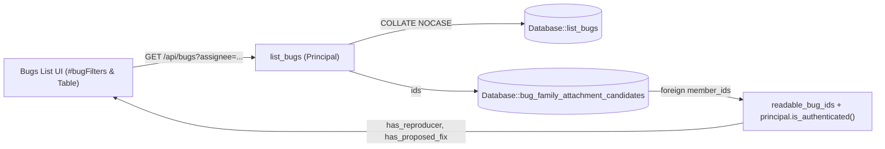

# Design: Bugs List UI Improvements (`My Bugs` Toggle & Attachment Badges)

## 1. Context & Motivation

Two workflow bottlenecks remain on the Bugs list page (`/#/`, `Bugs` mode):
1. **Manual Assignee Filtering**: Filtering for bugs assigned to oneself currently requires typing one's full login email into the `Assignee` text input, and `Database::list_bugs` compares `bugs.assignee = ?` case-sensitively even though `request_link` and `BugAction::Assign` preserve caller-supplied email casing.
2. **Hidden Attachment Signals**: Typed bug attachments (`reproducer` and `proposed_fix`, introduced in `DESIGN_BUG_COMMENT_KINDS_AND_REPRODUCER_AUTH.md`) are only visible after opening an individual bug page (`Reproducers` and `Fixes` tabs). Maintainers scanning the bugs table cannot see at a glance which bugs already carry a working reproducer or a proposed patch.

## 2. Requirements

| # | Requirement |
|---|---|
| R1 | **`My Bugs` Toggle Button**: Add a `My Bugs` toggle button inside `#bugFilters` next to `#bugAssigneeFilter` that filters the bugs list to the signed-in user's login email while preserving existing status, severity, security, and subsystem filters. |
| R2 | **Case-Insensitive Assignee Matching & `me` Alias**: Match `AssigneeFilter::Is` with `COLLATE NOCASE` in `Database::list_bugs` so email case differences between sign-in and assignment never hide assigned bugs, and accept `assignee=me` on `GET /api/bugs` for API/CLI parity. |
| R3 | **Attachment Badges in Bugs List**: Display distinct `Reproducer` and `Proposed Fix` badges on rows in the Bugs list when a bug (or any readable duplicate in its family) carries corresponding attachments, linking directly to `#/bug/<bugid>?tab=reproducers` and `#/bug/<bugid>?tab=fixes`. |
| R4 | **Access-Control Parity**: Gate `has_reproducer` on `principal.is_authenticated()` and restrict duplicate-family attachment aggregation to family members readable by `principal` (`readable_bug_ids`), matching `load_redacted_bug_evidence`. |

## 3. Architecture & Data Flow

### 3.1 `My Bugs` Toggle & Assignee Query (`static/index.html`, `src/server.rs`, `src/db.rs`)

- **Database (`src/db.rs`)**:
  - Change `AssigneeFilter::Is(who)` in `Database::list_bugs` from `assignee = ?` to `assignee = ? COLLATE NOCASE`.
- **HTTP API (`src/server.rs`, `src/api.rs`)**:
  - In `list_bugs`, recognize `assignee=me` (case-insensitively), resolving to `principal.email()` when non-empty and returning `400 Bad Request` when no email identity is present (such as unauthenticated `testing_mode`).
- **Web UI (`static/index.html`)**:
  - Harden `getAuthEmail()` so it falls back to the JWT `sub` claim or `config.user.email` if `sashiko_session_email` is missing or holds the legacy `'Authorized User'` placeholder.
  - Render `<button type="button" id="btnMyBugs">` next to `#bugAssigneeFilter` inside `#bugFilters`:
    - Marked `.active` (`aria-pressed="true"`) whenever `state.bugAssignee` matches `getAuthEmail()` case-insensitively (or `me`).
    - Clicking toggles `state.bugAssignee` between `getAuthEmail()` and `''`, updates `#bugAssigneeFilter`, resets `state.currentPage = 1`, and refreshes the list without resetting status/severity/subsystem filters.
    - Disabled with an explanatory `title` when no signed-in email is available, and synchronized in `updateAuthUI()`, `setBugFilter()`, and `clearSearch()`.

### 3.2 Attachment Badges (`src/db.rs`, `src/server.rs`, `static/index.html`)

- **Attachment Classification**:
  - Reproducer kinds: `reproducer`, `testcase`, `poc` (`is_reproducer_enrichment_kind`), matching `renderBugView` and `load_redacted_bug_evidence`.
  - Proposed-fix kinds: `proposed_fix`, `suggested_fix` (`is_proposed_fix_enrichment_kind`). Automated `fix_candidate` enrichments represent merged upstream commits (already surfaced via `Fixed by: <sha>` and `Fixed` status) and are intentionally excluded from the `Proposed Fix` badge.
- **Batch Family Query & Authorization (`src/db.rs`, `src/server.rs`)**:
  - Add `Database::bug_family_attachment_candidates(&self, ids: &[i64]) -> Result<Vec<(i64, i64, String)>>` returning `(root_id, member_id, kind)` across the `UNION` duplicate-family CTE (`ancestors` / `family`) for `ids`, returning early when `ids.is_empty()`.
  - In `resolve_bug_attachment_flags` (`src/server.rs`), collect any `member_id != root_id` when `!principal.has_global_bug_visibility()` and resolve them in a single `readable_bug_ids` call so cross-subsystem duplicates never leak attachment existence.
  - Emit `has_reproducer` (`principal.is_authenticated() && ...`) and `has_proposed_fix` booleans on each item in `GET /api/bugs` (and `GET /api/bug` derived from its already-redacted `evidence["activity"]`).
- **Web UI Rendering (`static/index.html`)**:
  - Render semantic pill links (`Reproducer` and `Proposed Fix`) in the Bugs list `Problem` cell using theme- and Okabe-Ito colorblind-safe CSS variables (`--status-inreview` and `--status-reviewed`), linking to `#/bug/<bugid>?tab=reproducers` and `#/bug/<bugid>?tab=fixes`.
  - Update `bindRowNav` to ignore clicks on `a[href]` elements inside table rows so clicking a badge navigates directly to the target tab without double-handling row navigation.
