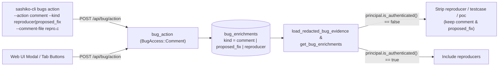

# Design: Typed Bug Comments (`proposed_fix`, `reproducer`) & Reproducer Login Gate

## 1. Context & Motivation

Bug pages already organize supplemental activity into separate tabs (`Comments`, `Fixes`, and `Reproducers`), and `render_bug_markdown` groups activity into corresponding sections. Previously, however:
1. `BugAction::Comment` always wrote `kind = "comment"`, giving users and CLI agents no supported way to attach a `proposed_fix` or `reproducer` enrichment directly via `POST /api/bug/action`, `sashiko-cli bugs action`, or the Web UI.
2. Direct `<project>-<uuid>` capability URLs (`/#/bug/<bugid>`, `/api/bug?bugid=<bugid>`, `/bug/<bugid>.md`) intentionally allow unauthenticated read access so bug links cited in `Link:` / `Closes:` trailers open without signing in. Keeping standalone reproducer attachments (`reproducer`, `testcase`, `poc`) gated behind authentication prevents anonymous visitors from downloading runnable testcases from public links.

## 2. Requirements

| # | Requirement |
|---|---|
| R1 | **Typed Comment Kinds**: Support `comment` (default), `proposed_fix`, and `reproducer` in `BugAction::Comment`, `sashiko-cli bugs action`, and the Web UI comment modal / tab headers. |
| R2 | **File / Stdin CLI Input**: Support `--comment-file <PATH>` (`-` for `stdin`, mutually exclusive with `--comment`) in `sashiko-cli bugs action` so multi-line C reproducers and `git format-patch` diffs can be posted without shell quoting or `ARG_MAX` issues. |
| R3 | **Authenticated-Only Reproducer Visibility**: Hide all reproducer-class enrichments (`reproducer`, `testcase`, `poc`) whenever `!principal.is_authenticated()`, including direct UUID capability links on `/api/bug`, `/api/bug/enrichments`, `/api/bug/markdown`, and `/bug/<bugid>.md`. |
| R4 | **Signed-In Capability Access Preserved**: Any authenticated user who can read a bug (including via a direct UUID capability link with a valid session or API token) sees reproducers normally. |

## 3. Architecture & Data Flow

### 3.1 API & CLI (`src/api.rs`, `src/bin/sashiko-cli.rs`)

- Introduce `BugCommentKind` (`#[serde(rename_all = "snake_case")]`, default `Comment`):
  - `Comment` (`"comment"`)
  - `ProposedFix` (`"proposed_fix"`)
  - `Reproducer` (`"reproducer"`)
- Extend `BugAction::Comment` with `#[serde(default)] kind: BugCommentKind`. Unknown `kind` strings fail deserialization (`422 Unprocessable Entity` over HTTP, actionable error on CLI).
- Extend `sashiko-cli bugs action` with:
  - `--kind <KIND>` (accepted only when `--action comment`).
  - `--comment-file <PATH>` (`-` reads `stdin`; mutually exclusive with `--comment`), usable wherever `--comment` is accepted.

### 3.2 Principal Authentication Tracking & Redaction (`src/access.rs`, `src/server.rs`)

- Add `authenticated: bool` (`Principal::is_authenticated(&self) -> bool`) to `Principal`:
  - `Principal::anonymous()` (and blocklisted or empty-email callers in `Principal::resolve`) have `authenticated: false`.
  - Validated JWT/session/API-token principals resolved via `Principal::resolve` and local `testing_operator()` have `authenticated: true`.
- Define `is_reproducer_enrichment_kind(kind: &str) -> bool` matching `"reproducer" | "testcase" | "poc"`.
- Enforce `!principal.is_authenticated()` filtering in both:
  1. `load_redacted_bug_evidence` (backing `GET /api/bug`, `GET /bug/{bugid}.md`, and `GET /api/bug/markdown`).
  2. `get_bug_enrichments` (`GET /api/bug/enrichments`).

### 3.3 Web UI (`static/index.html`)

- Add a `Comment type` `<select>` (`Comment`, `Proposed Fix`, `Reproducer`) inside the bug comment modal with dynamic labels, placeholders, visibility hint (noting reproducers are hidden from unauthenticated visitors), and separate per-kind draft storage so switching kinds does not clobber drafts.
- Add `Add Proposed Fix` and `Add Reproducer` action buttons in the `Fixes` and `Reproducers` tab headers when `canComment` is true, pre-selecting the corresponding `BugCommentKind` and switching to the target tab after submission.
