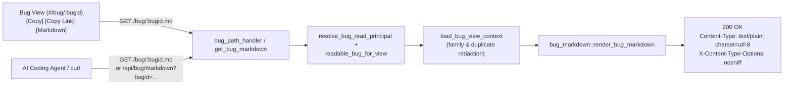

# Design: Agent-Ready Markdown Bug Prompt Endpoint & UI Link

## Context & Motivation

Individual bug pages (`#/bug/<bugid>`) under the **Bugs** menu currently expose two actions in the `Bug ID:` metadata row:
- **Copy**: copies the public `<project>-<uuid>` identifier.
- **Copy Link**: copies `<origin><pathname>#/bug/<bugid>`, a public capability URL suitable for citing the bug report in patch submissions.

Developers fixing pre-existing bugs increasingly hand the bug over to an AI coding agent (CLI coding assistants, IDE agents, or automated patch workflows). Copying fragments manually from the Web UI loses structured context (verified commit SHA, introducing commit, affected files and line locations, maintainer comments, reproducers) and leaves patch trailer conventions (`Fixes:`, `Reported-by:`, `Link:`) implicit.

Adding a **Markdown** link button right next to **Copy Link** that opens `/bug/<bugid>.md` (`text/plain; charset=utf-8`) solves both interactive and programmatic workflows:
1. Clicking **Markdown** opens the raw Markdown document inline in a browser tab ready to read or copy into an agent prompt.
2. Right-clicking (**Copy Link Address**) or passing `<base_url>/bug/<bugid>.md` directly gives an AI agent a self-contained, capability-accessible URL with all bug details and patch-formatting instructions.

## Architecture

### 1. HTTP Endpoints & Routing (`src/server.rs`)

- **`GET /bug/{bugid}` (`bug_path_handler`)**:
  - Axum's single-segment parameter `{bugid}` matches both `/bug/linux-<uuid>` and `/bug/linux-<uuid>.md`.
  - When `{bugid}` ends with `.md`:
    - Strip the `.md` suffix. If the remaining stem is empty, return `404 Not Found`.
    - Construct `BugQuery { id: None, bugid: Some(stem.to_string()), slug: None }` and serve the Markdown prompt.
  - Otherwise preserve the existing `307 Temporary Redirect` to `/#/bug/{bugid}`.
- **`GET /api/bug/markdown` (`get_bug_markdown`)**:
  - Accepts `Query<BugQuery>` (`?bugid=`, `?slug=`, or `?id=`), mirroring `/api/bug`.
- **Response Headers**:
  - `Content-Type: text/plain; charset=utf-8` so every browser renders the raw Markdown text inline in the tab instead of prompting to download a `.md` file, while HTTP clients and AI agents read the UTF-8 Markdown payload directly.
  - `X-Content-Type-Options: nosniff` so browsers never MIME-sniff untrusted bug text as HTML.

### 2. Access Control, Redaction & Fencing

- **Capability & Principal Enforcement**:
  - Both `/bug/{bugid}.md` and `/api/bug/markdown` run `resolve_bug_read_principal` followed by `readable_bug_for_view`.
  - Addressing a bug by `bugid` / `slug` grants `BugAccess::Read` capability access on that single bug (still honoring blocklists and scoped API token `max_access` ceilings).
  - Addressing a bug by sequential numeric `id` on `/api/bug/markdown?id=...` requires authentication (`401` when anonymous) and subsystem/global read authority (`404` when unauthorized).
- **Shared Redaction Boundary**:
  - Extract a shared helper in `src/server.rs` used by both `get_bug` and the Markdown handlers to resolve readable `duplicate_of` / `duplicates`, filter `bug_family(bug.id, false)` to `readable_family`, apply `redact_inaccessible_duplicate_enrichments`, and omit `candidate` / `raw_candidate` activity for principals without global bug visibility.
  - Raw LLM transcripts (`logs`), `raw_input`, `vector_json`, token counters, and internal SQLite row IDs (`Bug #<id>`) are never included.
- **Markdown Fence & Header Hygiene**:
  - Strip `\r` and `\n` from single-line metadata and trailer values so untrusted commit subjects or reporter strings cannot inject extra trailers or Markdown structure.
  - Wrap multi-line untrusted blocks (bug report description, reproducers, comments, fix candidates) in fenced blocks whose backtick count is `max(4, longest_backtick_run(text) + 1)`, preventing embedded triple-backtick fences, `< ... >` elision markers, or tab-indented C snippets from breaking document structure.

### 3. Public Base URL & Suggested Trailers (`src/bug_markdown.rs`)

#### Base URL Resolution
To produce accurate `Link:` URLs while preventing Host-header poisoning on configured deployments, resolve `<base_url>` (without trailing slash) in strict priority order:
1. `settings.server.mailed_link_base_url()` (`server.public_base_url` when set to a reachable `http`/`https` URL).
2. `settings.project.domain` when non-empty and syntactically valid (`https://<domain>`, or preserving an explicit `http://` / `https://` scheme).
3. Validated `Host` request header (strict ASCII hostname / IPv4 / bracketed IPv6 plus optional `:port`, rejecting `/` , `@`, `\`, whitespace, or control characters) for unconfigured local/self-hosted instances, choosing `https` when `X-Forwarded-Proto` is `https` or when the host has no non-443 port and is not loopback (`localhost`, `127.0.0.1`, `[::1]`), and `http` otherwise.
4. Default fallback: `https://sashiko.dev`.

From `<base_url>`:
- **Bug URL** (matches **Copy Link**): `<base_url>/#/bug/<encoded_bugid>`
- **Markdown URL**: `<base_url>/bug/<encoded_bugid>.md`

#### `Reported-by:` Derivation
1. If `bug.reporter` contains `@`, does not end with `@localhost`, and its bare email differs from `smtp.sender_address`, use `bug.reporter` directly (preserving external human/bot reporters).
2. Otherwise (Sashiko-discovered bugs where `bug.reporter` is `"sashiko"`, `"sashiko.dev"`, `"authorized client (...)"`, or matches `smtp.sender_address`), determine display name from `settings.project.name` (defaulting to `"Sashiko"`):
   - If `settings.smtp` is configured with a non-`@localhost` `sender_address`: use `sender_address` verbatim if it already carries `<...>`, else `<Display Name> <sender_address>`.
   - Otherwise default to `<Display Name> <sashiko@sashiko.dev>` (`Reported-by: Sashiko <sashiko@sashiko.dev>`).

#### `Fixes:` Derivation
Parse `bug.introduced_in_commit()` (falling back to `bug.introducing_commit_sha()`):
- Strip any trailing release tag annotation (` [v6.2-rc1]`) appended by `format_commit()`, since Linux `checkpatch.pl` forbids release tags on `Fixes:` lines.
- Truncate the commit hash to 12 lowercase hex characters.
- When a valid commit subject is present (and is not `"unknown"`), wrap it in double quotes if not already quoted:
  `Fixes: <12-char sha> ("<subject>")`
- When only a SHA is known (or subject is `"unknown"`), emit a placeholder subject `Fixes: <12-char sha> ("<commit subject>")` and instruct the agent to populate the exact subject via `git log -1 --format='Fixes: %h ("%s")' --abbrev=12 <sha>`.
- When no introducing commit is recorded, instruct the agent to identify the introducing commit via `git blame` / `git log` or omit `Fixes:` if it cannot be determined with confidence.
- When the target project is Sashiko itself (`ProjectId::Sashiko` or `sashiko-` bug prefix), include the repository's second `Fixes: <bugid>` trailer line in addition to any introducing-commit `Fixes:` line; for Linux kernel bugs, use `Link: <bug_url>` and never emit a non-SHA `Fixes:` tag.

### 4. Markdown Prompt Structure

The generated Markdown document is structured directly as an actionable prompt for an AI coding agent:
1. **Title & Agent Task Brief**: `# Fix <Project> Bug: <problem>` followed by concise engineering instructions (verify the bug still exists at `HEAD`, trace callers/locking/lifetimes, write a minimal root-cause fix without unrelated refactoring, validate build/tests).
2. **Bug Metadata**: Bug ID, Bug URL, Markdown URL, lifecycle/pipeline status (highlighting if already Fixed/Dismissed/Duplicate), calibrated severity + explanation, subsystems, affected files, structured code locations (`file:line (symbol)`), `verified_on_sha`, `introduced_in_commit`, `fixed_in_commit` (if any), and reported timestamp.
3. **Bug Description**: Full standalone plaintext defect report inside a dynamically-sized `text` code fence (or clear status note if analysis is still in progress).
4. **Supplemental Evidence** *(when present and readable)*: Reproducers, Maintainer Comments, and Prior Fix Candidates.
5. **Patch Formatting Guidance**: Step-by-step commit formatting rules (subsystem subject prefix discovery via `git log`, 72-column body wrapping, imperative mood) and a ready-to-use trailer block containing the suggested `Fixes:`, `Reported-by:`, `Link:`, and `Signed-off-by:` trailers plus verification notes (`checkpatch.pl`, `Closes:` note if required by target subsystem tooling, and no AI attribution trailers unless requested).

### 5. Web UI Integration (`static/index.html`)

In `renderBugView`:
- Place `<a id="btn-bug-markdown" class="copy-btn" href="bug/${encodeURIComponent(bugid)}.md" target="_blank" rel="noopener noreferrer" data-hint="Raw bug report and patch trailer guidance in Markdown — ready to use as an AI agent prompt" aria-label="Markdown — Raw bug report and patch trailer guidance in Markdown, ready to use as an AI agent prompt">Markdown</a>` immediately after `#btn-copy-bug-link`.
- Extend the `#btn-copy-bug-link` CSS rules to `#btn-bug-markdown` (including light, dark, colorblind, and `<= 768px` mobile hint positioning) and ensure `a.copy-btn` resets anchor underline and aligns cleanly alongside `<button class="copy-btn">`.

## Testing Plan

1. **Unit Tests (`src/bug_markdown.rs`)**:
   - `Fixes:` formatting across all `introduced_in_commit` shapes: `sha ("subject") [v6.x]`, `sha (subject)`, raw 40-char SHA, `"unknown"` subject, and `None`.
   - `Reported-by:` resolution across default config (`Sashiko <sashiko@sashiko.dev>`), custom `smtp.sender_address` (bare and `Name <email>`), `@localhost` filtering, and human `bug.reporter` emails.
   - Base URL resolution priority (`public_base_url` > `project.domain` > validated `Host` header > fallback) and rejection of malformed/injected `Host` headers.
   - Dynamic backtick fence escaping when bug descriptions or comments contain triple/quadruple backticks or CR/LF characters in titles.
2. **HTTP & ACL Integration Tests (`src/server.rs`)**:
   - `GET /bug/<bugid>` continues to return `307` redirect to `/#/bug/<bugid>`.
   - `GET /bug/<bugid>.md` and `GET /api/bug/markdown?bugid=<bugid>` work anonymously (capability read), return `200 OK` with `text/plain; charset=utf-8` and `X-Content-Type-Options: nosniff`, and include bug details and `Fixes:`, `Reported-by:`, and `Link:` trailers.
   - `GET /api/bug/markdown?id=<id>` enforces authentication (`401` anonymous) and subsystem ACLs (`404` unauthorized stranger, `200` authorized operator/maintainer), and scoped tokens with `BugAccess::None` are denied even by `bugid`.
   - Inaccessible duplicate counterparts and raw candidate/transcript logs are never leaked in the rendered Markdown.
