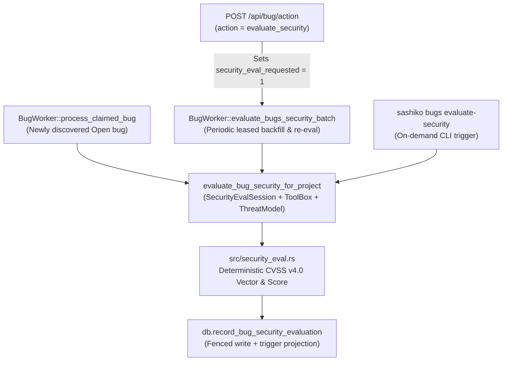

# Design: Bug Security Importance Evaluation (CVSS v4.0 & Project Threat Models)

## 1. Problem & Motivation

Sashiko tracks verified defects across target projects (`linux`, `qemu`,
`sashiko`, `gcc`) in the `bugs` database. Today each canonical bug receives an
engineering `Severity` (`Low`, `Medium`, `High`, `Critical`) via
`severity_calibration` (`src/workflows/linux_bug.rs`).

Engineering severity intentionally measures overall maintenance urgency rather
than security risk alone:

- A silent filesystem corruption on valid workloads, a UAPI regression, or a
  crash during normal `root`-initiated device unbind is `Critical` or `High`
  engineering severity even when no security trust boundary is crossed.
- Conversely, an unprivileged local information disclosure across user
  boundaries may have moderate operational blast radius (`Medium` engineering
  severity) while still being a genuine security vulnerability requiring CVE /
  security-team triage.
- Pre-existing bugs already stored in the `bugs` database prior to this feature
  have no structured security classification or score at all.

Operators, subsystem maintainers, and security teams need **every canonical bug
in the database—both already existing and newly added—to receive an orthogonal,
code-grounded security evaluation** based on industry best practices (**FIRST
CVSS v4.0**) gated by the target project's authoritative threat model.

## 2. Goals & Non-Goals

### Goals

1. **Orthogonal Security Evaluation**: Keep existing engineering `Severity`
   (`bugs.severity_int` and `severity_calibration`) unchanged while adding a
   dedicated `security_evaluation` enrichment and projected columns on `bugs`.
2. **Authoritative Threat-Model Gate**: Classify every canonical bug into
   `vulnerability`, `hardening`, or `not_security` strictly against the target
   project's threat model (for Linux, `Documentation/process/threat-model.rst`
   loaded at runtime via `KernelThreatModel::load`) after inspecting concrete
   caller privilege checks, file permissions, and configuration gates in code.
3. **Deterministic CVSS v4.0 Scoring**: Have the LLM output structured per-metric
   CVSS v4.0 enum values and code-grounded justifications, while Rust validates
   invariants and deterministically computes the exact `0.0`–`10.0` MacroVector
   score, qualitative severity rating, and canonical `CVSS:4.0/...` vector
   string via the `cvss` v3.0.0 crate. Non-security and hardening bugs score
   `0.0` with no CVSS vector.
4. **Complete Coverage (New + Existing Bugs)**:
   - Evaluate newly discovered canonical bugs immediately when they transition
     to `open` in `BugWorker`.
   - Automatically backfill existing canonical bugs (`open` first, then `fixed`
     and `closed`; skipping `dismissed` and `duplicate` rows) via a leased
     background sweep in `BugWorker`.
   - Provide manual CLI (`sashiko bugs evaluate-security` and
     `sashiko-cli bugs action`) and Web UI re-evaluation triggers.
5. **End-to-End Surfaces & Access Control**: Expose security scores, classes,
   and CVSS vectors across SQLite indexes, `GET /api/bugs` (filtering and
   sorting), `GET /api/bug`, `POST /api/bug/action`, `static/index.html`, and
   `sashiko-cli`, strictly preserving `Principal` and `BugAccess` boundaries.

### Non-Goals

- Replacing or altering engineering `Severity` calibration (`severity.md`) or
  initial bug verification/deduplication logic.
- Injecting CVSS scores or security labels into outbound LKML plaintext bug
  reports (`ReportSession`), where security hyperbole is counter-productive.
- Computing institution-specific CVSS Threat (`E`) or Environmental (`CR`, `IR`,
  `AR`, `MAV`, ...) metrics that depend on deployment-specific asset inventory
  or live exploit-intelligence feeds.

## 3. Threat-Model Gate & CVSS v4.0 Domain Model (`src/security_eval.rs`)

### 3.1 Three-Way Threat-Model Classification (`SecurityClass`)

Before any CVSS metric is scored, each bug is classified into one of three
mutually exclusive categories under the project's threat model:

| `SecurityClass` | Wire Value | Meaning | Score & Vector |
|---|---|---|---|
| `Vulnerability` | `"vulnerability"` | An untrusted or less-privileged actor can cross a trust boundary guaranteed by the project's threat model and cause concrete confidentiality, integrity, or availability impact. | Deterministic CVSS v4.0 score (`0.1`–`10.0`), `CVSS:4.0/...` vector |
| `Hardening` | `"hardening"` | Weakens a defense-in-depth mitigation, sanitizer, or bounds check without a concrete boundary-crossing exploit path on its own. | `0.0` (`score_tenths = 0`), `cvss_vector = None` |
| `NotSecurity` | `"not_security"` | Regular bug outside any guaranteed security boundary under the project's threat model. | `0.0` (`score_tenths = 0`), `cvss_vector = None` |

Project-specific trust boundaries:

- **Linux (`ProjectId::Linux`)**: Informed by
  `Documentation/process/threat-model.rst` (loaded from mainline via
  `KernelThreatModel::load`) and Linux Kernel CNA CVSS scoring practice. Any
  concrete defect with Confidentiality, Integrity, or Availability impact
  (memory corruption, OOB/uninitialized disclosure, crash/deadlock/leak, silent
  data corruption, or virtualization/IOMMU/DMA isolation breach across guest,
  nested L2->L1, or device boundaries) is classified as `vulnerability`, with
  access preconditions (`CAP_SYS_ADMIN` / VFS root-only `sysfs` `store` /
  `debugfs` / `tracefs` -> `PR:H`, crafted mounted image -> `UI:A`, physical bus
  manipulation -> `AV:P`) encoded in the CVSS metrics rather than zeroing the
  bug. Build/Kconfig fixes, dead code, docs/`kselftests`, and pure stat/telemetry
  quirks with zero CIA impact are `not_security`; provably redundant checks
  dominated by an existing guard are `hardening`.
- **QEMU (`ProjectId::Qemu`)**: Security boundaries are untrusted guest-to-host
  escapes or host DoS across virtualization configurations (`KVM`, `Xen`, and
  explicitly security-supported virtual devices) and untrusted network/image
  peers on production daemons (`qemu-nbd`, migration channels). Bugs reachable
  only via trusted management interfaces (`QMP`/`HMP`, CLI arguments) or TCG /
  experimental devices explicitly marked non-security-supported are
  `not_security`.
- **Sashiko (`ProjectId::Sashiko`)**: Security boundaries are untrusted mailing
  list patches, commit messages, git trees, forge webhooks, unauthenticated or
  low-privilege HTTP API callers (`BugAccess`), and prompt-injection paths
  affecting command execution, file reads, email routing, or secret exposure.
- **GCC (`ProjectId::Gcc`)**: Compiler ICEs or miscompilations on ordinary code
  are `not_security` unless the bug undermines a security-hardening codegen
  feature (`-fstack-protector`, `-fcf-protection`, sanitizers — typically
  `hardening` or `vulnerability` when silently eliding a guaranteed check) or
  allows untrusted input processing in a documented sandboxed toolchain path to
  compromise the host.

### 3.2 CVSS v4.0 Metrics & Deterministic Rust Scoring

When `security_class == SecurityClass::Vulnerability`, the LLM must supply all
11 mandatory FIRST CVSS v4.0 Base metrics (and may supply 3 code-observable
Supplemental metrics):

- **Exploitability Metrics**:
  - `AV` (`AttackVector`): `N` (Network), `A` (Adjacent), `L` (Local), `P` (Physical)
  - `AC` (`AttackComplexity`): `L` (Low), `H` (High)
  - `AT` (`AttackRequirements`): `N` (None), `P` (Present) — captures concrete
    deployment/configuration prerequisites or race-winning requirements distinct
    from attacker-controlled complexity
  - `PR` (`PrivilegesRequired`): `N` (None), `L` (Low), `H` (High)
  - `UI` (`UserInteraction`): `N` (None), `P` (Passive), `A` (Active)
- **Vulnerable System Impact Metrics**:
  - `VC` (`Confidentiality`): `H`, `L`, `N`
  - `VI` (`Integrity`): `H`, `L`, `N`
  - `VA` (`Availability`): `H`, `L`, `N`
- **Subsequent System Impact Metrics** (e.g., guest-to-host escape, container /
  namespace escape to host, or kernel compromise impacting downstream systems):
  - `SC`: `H`, `L`, `N`
  - `SI`: `H`, `L`, `N`
  - `SA`: `H`, `L`, `N`
- **Optional Supplemental Metrics** (included in the canonical vector when
  known; Supplemental metrics do not alter the numeric Base score per FIRST
  CVSS v4.0):
  - `AU` (`Automatable`): `N`, `Y`
  - `R` (`Recovery`): `A` (Automatic), `U` (User), `I` (Irrecoverable)
  - `RE` (`ResponseEffort`): `L`, `M`, `H`

`src/security_eval.rs` converts these typed enums into a canonical
`CVSS:4.0/AV:.../AC:.../AT:.../PR:.../UI:.../VC:.../VI:.../VA:.../SC:.../SI:.../SA:...`
string, parses it through `cvss::v4::Vector` (`cvss = "3.0.0"`, `Apache-2.0 OR MIT`),
and extracts:

- `score_tenths: u8` (`(score.value() * 10.0).round() as u8`, bounded to `0..=100`)
- `score: f64` (`f64::from(score_tenths) / 10.0`)
- `qualitative_rating: SecurityRating` (`None` `0.0`, `Low` `0.1–3.9`,
  `Medium` `4.0–6.9`, `High` `7.0–8.9`, `Critical` `9.0–10.0`)
- `cvss_vector: Option<String>` (canonical `CVSS:4.0/...` `Vector::to_string()`)
- `cvss_v31_vector: Option<String>` and `cvss_v31_score: Option<f64>`
  (deterministic projection onto `cvss::v3_1::Vector` for CNA interoperability)

Validation rules enforced before accepting LLM output (returning specific retry
instructions on violation):

1. If `security_class == Vulnerability`:
   - `cvss_v4` metrics object must be present.
   - At least one impact metric (`VC`, `VI`, `VA`, `SC`, `SI`, `SA`) must be
     non-`N` (a vulnerability with zero impact has CVSS `0.0` and contradicts
     `Vulnerability`).
   - `trust_boundary` and `attacker_model` must be non-empty strings naming the
     crossed boundary and required actor privileges.
   - `metric_justifications` must justify the chosen exploitability and impact
     metrics with concrete code/symbol references.
2. If `security_class` is `Hardening` or `NotSecurity`:
   - `cvss_v4` must be `null` / omitted (or if provided by mistake, rejected by
     validation so the model resolves the contradiction explicitly).
   - `summary` must cite the concrete code precondition or threat-model clause
     establishing why no guaranteed trust boundary is breached (anti-charity
     rule: callers must be verified rather than assumed privileged).

## 4. Database Schema & Projection (`021_bug_security_evaluation.sql`)

### 4.1 `security_evaluation` Enrichment Payload

Each completed evaluation inserts one `bug_enrichments` row with
`kind = 'security_evaluation'`:

- `content`: Concise human-readable security assessment summary.
- `data_json`:
  ```json
  {
    "security_class": "vulnerability",
    "score": 8.5,
    "score_tenths": 85,
    "qualitative_rating": "High",
    "cvss_vector": "CVSS:4.0/AV:L/AC:L/AT:N/PR:L/UI:N/VC:H/VI:H/VA:H/SC:N/SI:N/SA:N",
    "cvss_v31_vector": "CVSS:3.1/AV:L/AC:L/PR:L/UI:N/S:U/C:H/I:H/A:H",
    "cvss_v31_score": 7.8,
    "trust_boundary": "Unprivileged local user syscall ioctl -> kernel heap",
    "attacker_model": "Local unprivileged user able to open /dev/...",
    "summary": "...",
    "cvss_v4": { ... },
    "metric_justifications": { ... },
    "evaluated_on_sha": "05441d697f7f...",
    "threat_model_sha": "05441d697f7f..."
  }
  ```
- `tokens_in`, `tokens_out`, `tokens_cached`: Recorded on the enrichment (and
  automatically mirrored to `ai_interactions` by `insert_bug_enrichment`).
- `logs`: Zstd-compressed LLM session transcript (loaded only on `/api/bug/raw`,
  while `get_bug` and `hydrate_bugs_batch` select `NULL as logs`).

### 4.2 Projected Columns, Indexes & Trigger on `bugs`

Migration `src/migrations/021_bug_security_evaluation.sql` (`PRAGMA user_version = 21`)
adds six columns to `bugs`:

```sql
ALTER TABLE bugs ADD COLUMN security_score_tenths INTEGER
    CHECK (security_score_tenths IS NULL OR (security_score_tenths BETWEEN 0 AND 100));
ALTER TABLE bugs ADD COLUMN security_class TEXT
    CHECK (security_class IS NULL OR security_class IN ('vulnerability', 'hardening', 'not_security'));
ALTER TABLE bugs ADD COLUMN cvss_vector TEXT;
ALTER TABLE bugs ADD COLUMN security_evaluated_at INTEGER;
ALTER TABLE bugs ADD COLUMN security_eval_attempts INTEGER NOT NULL DEFAULT 0;
ALTER TABLE bugs ADD COLUMN security_eval_requested INTEGER NOT NULL DEFAULT 0
    CHECK (security_eval_requested IN (0, 1));
```

Why integer tenths (`0..=100`) instead of `REAL`:

- Exact comparisons (`security_score_tenths >= 70` for `7.0+`) with zero IEEE-754
  rounding ambiguity in SQLite indexes.
- Cleanly distinguishes **unevaluated** (`NULL`) from **evaluated non-security /
  hardening** (`0`).

Indexes and projection trigger:

```sql
CREATE INDEX IF NOT EXISTS idx_bugs_security_score
    ON bugs(security_score_tenths DESC, id DESC);

CREATE INDEX IF NOT EXISTS idx_bugs_security_class
    ON bugs(security_class, security_score_tenths DESC, id DESC);

CREATE INDEX IF NOT EXISTS idx_bugs_security_backfill
    ON bugs(security_eval_requested DESC, lifecycle_status, severity_int DESC, id DESC)
    WHERE duplicate_of_id IS NULL AND pipeline_state = 'succeeded';

CREATE TRIGGER IF NOT EXISTS trg_bug_enrichments_project_security
AFTER INSERT ON bug_enrichments
WHEN new.kind = 'security_evaluation' AND new.data_json IS NOT NULL
BEGIN
    UPDATE bugs
       SET security_score_tenths = CASE
               WHEN json_extract(new.data_json, '$.score_tenths') BETWEEN 0 AND 100
               THEN CAST(json_extract(new.data_json, '$.score_tenths') AS INTEGER)
               ELSE security_score_tenths
           END,
           security_class = COALESCE(
               json_extract(new.data_json, '$.security_class'),
               security_class
           ),
           cvss_vector = CASE
               WHEN json_extract(new.data_json, '$.security_class') = 'vulnerability'
               THEN json_extract(new.data_json, '$.cvss_vector')
               ELSE NULL
           END,
           security_eval_requested = 0
     WHERE id = new.bug_id;
END;
```

## 5. Workflow & Leased Worker Architecture



### 5.1 `SecurityEvalSession` (`src/workflows/linux_bug.rs`)

`SecurityEvalSession` implements `LlmSession<Output = SecurityEvaluation>`:

- **Inputs**: `ProjectId`, `KernelThreatModel` (when `Linux`), canonical bug
  title, canonical/report description, verification reasoning, calibrated
  engineering severity + explanation, verified code locations, prefetched source
  snippets around those locations, target git SHA (`verified_on_sha` falling
  back to mainline `HEAD`), and optional `Arc<ToolBox>`.
- **Tools**: Read-only repository inspection (`git_read_files`, `git_grep`,
  `git_blame`, `git_log`, `git_show`) with both `call_tool` and `call_tools`
  implemented via a shared consecutive-duplicate tool-call guard that converts
  `ToolBox` errors into `{"error": ...}` JSON values without aborting the turn.
- **Anti-Charity & Untrusted Data Guardrails**: Stored bug text and source
  snippets are treated strictly as untrusted data; file paths are sanitized via
  `sanitize_repo_relative_path` before prefetching; dismissing security impact on
  privilege grounds requires citing the concrete capability check, file mode, or
  Kconfig dependency in code.

### 5.2 Newly Added Bugs (`BugWorker::process_claimed_bug`)

Every path that adds a canonical bug to `bugs` (`BugWorker::run` for patch
review findings, `sashiko scan --submit-bugs`, and `POST /api/bugs/analyze`)
funnels through `BugWorker::process_claimed_bug`.

When `process_issue_worker_for_project` returns `BugOutcome::NewlyDiscovered { bug }`
and `linux_bug.security_eval_enabled` is `true`:

1. The bug is already durably committed with `lifecycle_status = 'open'` and
   `pipeline_state = 'succeeded'`, while the worker still holds `locked_by = claim_id`.
2. `process_claimed_bug` immediately invokes `evaluate_bug_security_for_project`
   under `run_while_leased` and persists the result via
   `record_bug_security_evaluation` (which clears the lease) before returning the
   refreshed `Bug`.
3. If `SecurityEvalSession` fails transiently or loses its lease, `BugWorker`
   logs a `warn!`, increments `security_eval_attempts`, releases the lease, and
   still returns the newly discovered `Bug`—ensuring a verified defect is never
   lost and is automatically retried by the background sweep.

### 5.3 Existing Bugs Backfill (`BugWorker` & `sashiko bugs evaluate-security`)

`Database::claim_bug_for_security_eval` atomically claims one canonical
`succeeded` bug whose lease is free (`locked_by IS NULL OR lease_expires_at <= now`)
matching:

- `duplicate_of_id IS NULL AND pipeline_state = 'succeeded'`
- `lifecycle_status IN ('open', 'fixed', 'closed')` (`dismissed` and `duplicate`
  bugs are skipped unless an operator explicitly requests single-bug evaluation)
- Either `security_eval_requested = 1` **or**
  `(security_score_tenths IS NULL AND security_eval_attempts < max_attempts)`

Ordering prioritizes:

1. `security_eval_requested DESC` (explicit UI/CLI re-evaluation requests first),
2. `CASE lifecycle_status WHEN 'open' THEN 0 WHEN 'fixed' THEN 1 ELSE 2 END ASC`,
3. `severity_int DESC`,
4. `id DESC`.

Concurrency & pagination invariants:

- Claiming sets `locked_by`, `lease_expires_at`, and increments
  `security_eval_attempts` **without** changing `pipeline_state` (remains
  `'succeeded'`) and **without** touching `updated_at`, so `check_open_bugs_upstream`'s
  `ORDER BY updated_at ASC` sweep is never perturbed.
- `renew_bug_lease` and `begin_bug_write` already accept
  `pipeline_state IN ('running', 'succeeded')`.
- `record_bug_security_evaluation` fences on `locked_by = claim_id`, inserts the
  `security_evaluation` enrichment (firing `trg_bug_enrichments_project_security`),
  and clears `locked_by` / `lease_expires_at` in one short transaction.

For operators running offline or one-shot backfills without starting the HTTP/NNTP
daemon, `sashiko bugs evaluate-security` supports:

- `--bug <BUGID>` — evaluate (or re-evaluate) a specific `<project>-<uuid>` bug.
- `--limit <N>` — evaluate up to `N` eligible canonical bugs (defaults to all
  eligible unevaluated canonical bugs in batches).
- `--re-evaluate` — re-evaluate already-scored canonical bugs as well.

## 6. Configuration, HTTP API, Web UI & CLI Surfaces

### 6.1 Configuration (`[linux_bug]`)

Added to `LinuxBugSettings` (`#[serde(deny_unknown_fields)]`, all with
`#[serde(default = "...")]`), `Settings.toml`, and `docs/configuration.md`:

- `security_eval_enabled = true`
- `security_eval_interval_seconds = 60`
- `security_eval_batch_size = 25`

### 6.2 HTTP API & Access Control (`src/api.rs`, `src/server.rs`)

- **`GET /api/bugs`**:
  - Query parameters:
    - `min_security_score`: optional float in `0.0..=10.0` (validated; invalid or
      out-of-range values return `400 Bad Request`), converted to
      `min_security_score_tenths`.
    - `security_class`: optional comma-separated filter (`vulnerability`,
      `hardening`, `not_security`; unknown values return `400 Bad Request`).
    - `sort_by`: adds `"security_score"` (alias `"security"`), ordered by
      `security_score_tenths IS NULL ASC, security_score_tenths {dir}, severity_int DESC, id {dir}`
      so unevaluated `NULL` rows always sort after scored rows in both `DESC` and
      `ASC` directions.
  - Each returned item includes `security_score` (`Option<f64>`),
    `security_rating` (`Option<&'static str>`), `security_class`
    (`Option<&'static str>`), `cvss_vector` (`Option<String>`), and
    `security_eval_requested` (`bool`).
- **`GET /api/bug` & `GET /api/bug/markdown`**:
  - Includes the summary fields above plus structured `security_evaluation`
    details (trust boundary, attacker model, summary, per-metric justifications,
    evaluated commit SHA).
  - `bug_evidence` (`activity`) includes `security_class`, `security_score`,
    `security_rating`, and `cvss_vector` on `security_evaluation` events while
    keeping raw `logs` and token counts gated behind `GET /api/bug/raw`
    (`Principal::has_global_bug_visibility()`).
- **`POST /api/bug/action`**:
  - Adds `BugAction::EvaluateSecurity` (`{"action": "evaluate_security"}`).
  - Enforces `!state.read_only` and `BugAccess::Manage` (the same authorization
    level required to triage, assign, close, or dismiss a bug), sets
    `security_eval_requested = 1` and resets `security_eval_attempts = 0`, and
    records an `audit` trail entry.

### 6.3 Web UI (`static/index.html`) & `sashiko-cli`

- **Bugs List View**:
  - Security filter `<select>`: `All Security`, `Vulnerabilities Only`,
    `CVSS 9.0+ (Critical)`, `CVSS 7.0+ (High+)`, `CVSS 4.0+ (Medium+)`,
    `Hardening`, `Non-Security`.
  - Sortable `Security` column displaying a color-coded CVSS v4.0 badge (e.g.
    `8.8 High` for vulnerabilities, muted `0.0 Hardening` / `0.0 Non-sec`, or
    `Pending` / `Queued` when unevaluated or queued for re-evaluation).
- **Bug Detail View**:
  - `Security:` row in bug metadata showing the CVSS v4.0 badge, security class,
    copyable `CVSS:4.0/...` vector pill, trust boundary, and summary.
  - `"Re-evaluate security"` button in the manage menu when `canManage`.
  - Dedicated rendering for `security_evaluation` cards in the `Analysis` tab.
- **`sashiko-cli`**:
  - `sashiko-cli bugs list`: adds `--min-security-score <SCORE>`,
    `--security-class <CLASS>`, `--sort-by <FIELD>`, `--sort-order <asc|desc>`,
    and displays a `SECURITY` column in text output.
  - `sashiko-cli bugs show`: displays the security score, rating, class, CVSS
    vector, trust boundary, and summary.
  - `sashiko-cli bugs action <ID> --action evaluate_security`: queues security
    re-evaluation via `POST /api/bug/action`.
