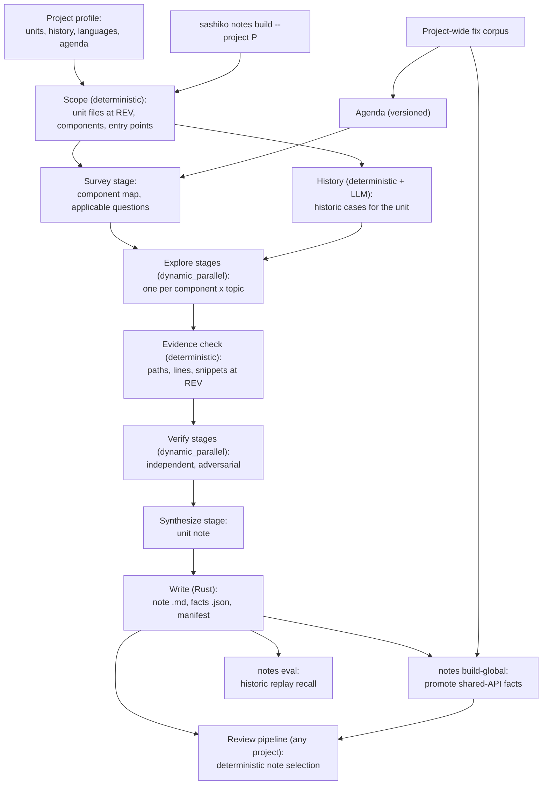

# Design: Code Notes Engine

## 1. Overview & Motivation

Sashiko reviews a patch with a few thousand lines of context: the diff,
prefetched definitions, and whatever the model finds with git tools within
a bounded number of turns. What it lacks is the understanding a maintainer
carries in their head: how a component serializes its state, who owns an
object at each stage of its life, which internal contracts are easy to
break, and which mistakes keep coming back as bug fixes.

Today that knowledge comes from hand-written guides (for Linux, the
`subsystem/*.md` files in the vendored review prompts). They cover a
fraction of the code, drift as it changes, and nobody can say which
statements in them are still true. Every new project Sashiko supports
(GCC is in progress; Sashiko reviews itself) needs the same knowledge
written again by hand.

The code notes engine gives Sashiko a way to **read a project's source,
understand it deeply, and write notes** that the review pipeline loads
later. Notes come from an agentic workflow that explores the code with the
existing git tools, verifies every claim against the code, and writes the
result as reviewable files in the prompt tree.

The engine is **project-agnostic**. Linux is the first target, but nothing
in the core knows about `MAINTAINERS`, `Fixes:` trailers or C. Those are
supplied by a per-project profile, so the same engine can build notes for
a compiler, a database, or Sashiko itself.

### Design Goals

- **Deep, not broad:** every note statement comes from reading the code
  paths involved, not from summarizing file headers.
- **Evidence-backed:** each statement carries code evidence (path, line
  range, snippet) at a pinned revision and is independently verified
  before it is written.
- **Project-agnostic core, declarative adapters:** ownership, bug history,
  language and domain knowledge are pluggable; adding a project means
  writing a profile, not changing the engine.
- **Version-agnostic agenda, version-specific notes:** research questions
  never name functions or versions; the notes they produce are concrete
  and pinned to the revision they were built from.
- **Two scopes:** per-unit notes (one ownership unit such as a Linux
  `MAINTAINERS` section or a GCC Bugzilla component, split into components
  when large) and global notes (cross-cutting facts about shared APIs and
  project-wide conventions).
- **Reviewable artifacts:** notes are committed files, produced by a CLI
  command and reviewed by humans in pull requests like any other prompt.
- **Incremental:** when the code moves, only notes whose evidence changed
  are re-verified or rebuilt.
- **Bounded cost:** explicit per-unit budgets, resumable runs, response
  caching, and a dry-run plan that estimates cost before spending it.

### Non-Goals

- Replacing human maintainer guidance. Subjective expectations (style,
  process, direction) stay hand-written; the engine writes objective
  facts about how the code works.
- Exploring code at review time. Review keeps its current budget; the
  engine moves deep exploration offline so review can reuse it.
- Supporting every revision of a project from day one. The first version
  builds one pinned revision per project; per-branch notes are an
  extension (section 12).

## 2. Concepts

| Term | Meaning |
| :--- | :--- |
| **Project profile** | Declarative description of a project's ownership units, bug history conventions, languages, agenda modules and size limits (section 3). |
| **Unit** | One research job: an ownership unit from the profile (a Linux `MAINTAINERS` section, a GCC Bugzilla component, a module of a smaller project), or a component of a large one. |
| **Component** | A cluster of files inside a unit (a directory, or files sharing a private header or module), small enough for one exploration stage. |
| **Agenda** | Version-agnostic research questions: universal, per language and per domain. They tell the explorer *what to understand*, not what to write. |
| **Fact** | One atomic, verifiable statement about the code (invariant, locking rule, lifetime rule, API contract, error-handling rule, external contract, or known pitfall), with evidence. |
| **Dismissed hypothesis** | A suspected rule the explorer investigated and found to be false, kept so later stages and humans do not re-investigate it. |
| **Historic case** | A past bug fix together with the change that introduced the bug (when known). It names a rule the code depends on and is used for prioritization, evaluation and refresh (section 9). |
| **Unit note** | Rendered markdown for one unit, built from its verified facts. |
| **Global note** | Rendered markdown for a cross-cutting topic (an API family or project-wide convention), built from facts promoted out of many units. |
| **Manifest** | Machine-readable index of a project's notes: unit, files covered, symbols, revision, fingerprints, model, agenda version. |

## 3. Project Profiles

Everything project-specific lives in a profile,
`projects/<project>/prompts/notes/profile.toml`, plus the project's
agenda files. The profile ships in the prompt bundle, so it is available
when `sashiko` runs inside the target project's repository; `--profile`
overrides it. The core
engine reads only the abstractions below.

### 3.1 Unit source

Answers two questions: *which units exist and which files does each own*,
and *which units does a given file belong to* (the second is also what
review uses to select notes). Implementations:

| Unit source | Used by | How units are formed |
| :--- | :--- | :--- |
| `maintainers` | Linux | `MAINTAINERS` sections with `F:`/`X:`/`N:` patterns (existing `MaintainersIndex`). |
| `component_map` | GCC, databases | A table in the profile mapping named components to path globs (for GCC, Bugzilla components such as `tree-optimization` to `gcc/tree-ssa-*.cc`, `gcc/match.pd`, ...). Used when ownership metadata has no machine-readable file patterns. |
| `codeowners` | GitHub-hosted projects | `CODEOWNERS` entries, grouped by owner set. |
| `directories` | Small projects, fallback | Directories a fixed depth below configured roots. Files shallower than that depth either form one unit per directory or, with `shallow_files = "per_module"`, one unit per file stem, so a Rust module file `src/db.rs` joins the `src/db/` unit. Sashiko itself (`src/workflow/`, `src/toolbox/`, `src/db`, ...) fits here. |

All sources share the overlap policy: a file owned by several units is
explored by the most specific one and listed as shared by the others. Very
widely shared code (core headers, common libraries) becomes a global topic
instead (section 9.5).

### 3.2 History source

Turns commit history into historic cases. Two parts:

- **Fix detection**, configured as patterns:
  - Linux: `Fixes: <sha>` trailers.
  - GCC: `PR <component>/<id>` references (the GCC review design in PR
    #661 counts ~20.5k such commits since 2020).
  - GitHub projects: `Fixes #<id>` / `Closes #<id>`.
  - Fallback: revert commits and an LLM classifier over commit messages
    (marked as lower confidence).
- **Introducing-change resolution**, tried in order:
  1. An explicit commit ID in the fix (Linux `Fixes:`; GCC `caused by
     <sha>`).
  2. A project revision descriptor resolved to a commit (GCC
     `r15-4321-g<sha>`; ~1.5k GCC regression fixes cite one).
  3. An SZZ-style estimate: blame the lines the fix changed at the fix's
     parent. Estimated introductions are flagged and reported separately
     in evaluation (section 9.3).

A historic case is usable for prioritization and notes recall even when no
introducing change is known; only review replay needs one.

### 3.3 Language adapters

Per language: which files are source (and which are generated or test
data), and how to list entry points cheaply before any LLM call.

| Language | Entry points |
| :--- | :--- |
| C | Exported symbols (Linux `EXPORT_SYMBOL*`), operation tables (`struct *_ops` initializers), public headers. |
| C++ | Public headers, virtual interfaces, registration points (GCC pass registration, target hooks). |
| Rust | `pub` items, trait definitions and impls, module tree. |
| Other | Public headers or interface files, plus the most-referenced symbols by `git grep` counts. |

A project can mix languages (GCC: C++, machine description `.md` files,
`match.pd`); the profile lists them with their file patterns, and unknown
formats fall back to the generic adapter.

### 3.4 Agenda modules

- **Universal**: language- and domain-agnostic questions about
  synchronization, object lifetimes, initialization and unwind,
  asynchronous work, error handling, API contracts and state machines.
- **Language**: memory and lifetime questions specific to C, C++
  (ownership through RAII, exception safety), Rust (unsafe invariants,
  `Send`/`Sync` assumptions), and so on.
- **Domain**: per project family. Examples:
  - *Kernel*: execution contexts, interrupt and DMA rules, hotplug and
    power transitions.
  - *Compiler*: IR invariants between passes, pass ordering assumptions,
    target hook contracts, garbage-collector roots, wrong-code versus
    internal-error failure modes.
  - *Database*: transaction and isolation guarantees, WAL and crash
    recovery ordering, buffer and lock manager protocols, on-disk format
    and upgrade compatibility, replication consistency.

A project's agenda is derived from its own bug history (section 9.1), so a
compiler's agenda is shaped by compiler bugs, not kernel bugs.

### 3.5 Fact kinds

A fixed, generic set shared by every project: `Invariant`, `LockingRule`,
`LifetimeRule`, `ApiContract`, `ErrorHandling`, `Concurrency`,
`ExternalContract` (hardware, operating system, file or wire format, ABI),
`Pitfall`, `Other`. Domain detail goes into the statement, not the kind,
so tooling and review integration stay project-independent.

### 3.6 Profile example

```toml
# projects/gcc/prompts/notes/profile.toml
[units]
source = "component_map"

[units.components]
"tree-optimization" = ["gcc/tree-ssa-*.cc", "gcc/tree-vect-*.cc", "gcc/match.pd", "gcc/value-range*"]
"rtl-optimization"  = ["gcc/combine.cc", "gcc/lra-*.cc", "gcc/ira*.cc", "gcc/simplify-rtx.cc"]
"c++"               = ["gcc/cp/**"]
# ...

[history]
fix_patterns = ['PR [a-z+-]+/\d+']
introducing = ["explicit_sha", "gcc_revision_descriptor", "szz"]

[languages]
"c++" = ["**.cc", "**.h"]
"gcc-md" = ["gcc/config/**.md"]
skip = ["gcc/testsuite/**", "**/ChangeLog*", "**/DATESTAMP"]

[agenda]
modules = ["universal", "lang/cpp", "domain/compiler"]

[limits]
component_lines = 15000
unit_note_bytes = 16384
```

The Linux profile uses `source = "maintainers"`, `fix_patterns` for the
`Fixes:` trailer, the C adapter and the kernel domain module.

## 4. Architecture



Everything runs locally from the CLI, without the daemon or database,
following the `sashiko review` path (`local_review.rs`): settings, AI
provider and decorators, `ToolBox` over the repository, `WorkflowEngine`.
The git tools are already project-independent.

## 5. CLI

```
sashiko notes plan    --project P [--unit NAME]... [--rev REV] [--json]
sashiko notes build   --project P [--unit NAME]... [--all] [--rev REV] [--resume]
sashiko notes refresh --project P [--rev NEW_REV]
sashiko notes build-global --project P
sashiko notes check   --project P
sashiko notes eval    --project P --unit NAME --build-rev REV [--until REV2]
```

- `plan` prints the units, their components, file and line counts, and an
  estimated token range per unit. It makes no LLM calls.
- `build` runs the workflow for the selected units and writes notes.
  `--resume` skips units whose outputs already exist in the work
  directory (section 12).
- `refresh` re-verifies notes against a newer revision (section 11).
- `build-global` consolidates global notes from all unit facts.
- `eval` runs historic replay for a unit (section 9.3): notes built at
  `--build-rev` are scored against fixes for bugs introduced after it.
- `check` validates the manifest, note sizes, and that every fact's
  evidence still resolves at the manifest revision. It runs in CI.

`--project` uses the existing global project flag. `REV` defaults to the
repository HEAD and is resolved to a commit SHA once; the `ToolBox`
virtual head is set to it so every tool call reads the same revision.

## 6. Scoping (deterministic)

1. **Enumerate unit files.** `git ls-tree -r --name-only REV`, filtered by
   the unit source. For Linux, `MaintainersIndex` needs small extensions:
   lookup by section title, retaining raw `F:`/`X:` patterns, and parsing
   `S:` (status) so orphaned or obsolete sections can be skipped.
2. **Filter.** Keep the profile's source languages; skip generated files,
   test data and documentation. Documentation stays readable by the
   explorer on demand. Inline test code (a trailing Rust `#[cfg(test)]`
   module) is counted separately and does not drive component sizes or
   cost estimates.
3. **Split into components.** A unit larger than `component_lines` is
   split along directories, then by include or module affinity, until
   each component fits.
4. **Entry points.** The language adapters list each component's entry
   points, giving the survey stage a starting map without spending LLM
   turns on it.

## 7. Workflow

The workflow lives in `src/workflows/code_notes.rs` and follows the
declarative engine (`DESIGN_DECLARATIVE_AI_WORKFLOWS.md`). Each stage has
one focused job, minimal but sufficient context, a JSON schema and a
validator that returns actionable errors. Stage prompts are generic; the
profile's agenda modules and domain vocabulary are the only
project-specific inputs.

### 7.1 Survey

- Input: component file lists, sizes, entry points, the agenda.
- Tools: all git read tools, bounded turns.
- Output: per component, the key data structures and objects, the
  concurrency domains (contexts the code runs in), the external interfaces
  it depends on, and which agenda topics apply. Every topic is marked
  `applies`, `does_not_apply` (with a reason) or `unknown`, so the model is
  never forced to invent relevance.

### 7.2 History

- Deterministic part: the unit's historic cases from the history source
  (section 3.2), over a configurable window, with subject, introducing
  change and files. Computed from `git log REV`, so only ancestors of REV
  are visible (this keeps historic replay honest, section 9.3). It needs
  a path filter on `git_log` or an internal helper, since the list is
  computed in Rust.
- LLM part: classify each case by agenda topic and summarize the violated
  rule in one sentence, batched 10-20 cases per call.
- Output: per topic, the rules that were broken in practice, with fixing
  commit IDs. Explorers use these as priorities; they are not facts until
  verified against current code. Section 9 covers the other roles of the
  bug history.

### 7.3 Explore (map)

- One stage per component and topic group, run with `dynamic_parallel`.
  Stage names come from a static table, like the post-verification
  stages.
- Input: the component map from the survey, the topic's agenda questions,
  and the history findings for that topic.
- The prompt instructs the model to trace real code paths (callers,
  callees, lock acquisitions, ownership transfers, error unwinds) and to
  answer the questions with facts, not prose.
- Output schema (abridged):

```json
{
  "facts": [{
    "id": "F1",
    "kind": "Invariant | LockingRule | LifetimeRule | ApiContract | ErrorHandling | Concurrency | ExternalContract | Pitfall | Other",
    "statement": "one sentence a reviewer can check a patch against",
    "scope": {"files": ["..."], "symbols": ["..."]},
    "evidence": [{"path": "...", "start_line": 10, "end_line": 24, "snippet": "..."}],
    "from_history": ["<fix commit>"],
    "questions": ["SYNC-3"]
  }],
  "dismissed_hypotheses": [{"statement": "...", "reason": "...", "evidence": []}],
  "open_questions": ["..."]
}
```

- Validator: every fact has at least one evidence entry, a known `kind`,
  a statement under a length limit, and scope symbols that appear in its
  evidence. The validator tells the model which fact broke which rule.

### 7.4 Evidence check (deterministic)

An `ExecutableStage` that, for every evidence entry, confirms the path
exists at REV, the line range is valid, and the snippet matches the file
content in that range (whitespace-normalized). Facts with broken evidence
are returned to verification marked as such, never written.

### 7.5 Verify

- Independent stages (fresh context, different instructions, optionally a
  different model) re-check batches of facts against the code.
- Anti-charity directive: a fact is confirmed only when the verifier cites
  code that proves it. "Plausible" is not enough, and missing callers or
  unhandled paths refute it.
- Output per fact: `confirmed`, `refuted` (with counter-evidence) or
  `unverifiable`. The validator requires every fact ID to be accounted
  for, following the `DESIGN_REVIEW_MAP.md` lineage rules.
- Refuted facts become dismissed hypotheses. Only confirmed facts reach
  synthesis.

### 7.6 Synthesize (reduce)

- Input: confirmed facts and dismissed hypotheses for the unit.
- Output: the unit note in a fixed structure (section 8.1), within the
  profile's byte budget. Facts are deduplicated, grouped by kind, and
  ordered by review value (history-backed facts first).
- Facts about shared APIs defined outside the unit are tagged as global
  candidates instead of being written into the unit note.

## 8. Output

### 8.1 Files

```
projects/<project>/prompts/notes/<branch-id>/
  manifest.json
  units/<unit-slug>.md
  units/<unit-slug>.facts.json
  global/<topic-slug>.md
  global/<topic-slug>.facts.json
```

- **Unit note (`.md`):** a header with the unit name, revision and build
  date, then fixed headings: *Architecture & Data Flow*,
  *Synchronization*, *Object Lifetimes*, *API Contracts*, *Error
  Handling*, *External Contracts*, *Known Pitfalls (from history)*. Empty
  headings are omitted. Each bullet is a fact statement with compact
  references (`file:function`), not full snippets, to keep review prompts
  small.
- **Facts sidecar (`.facts.json`):** the full facts with evidence,
  verification verdicts and fixing commits. Used by `refresh`, `check`,
  global consolidation, and humans auditing a statement.
- **Manifest:** per note, the unit name, covered files with content hashes,
  the symbols mentioned, REV, model, agenda version and byte size.

### 8.2 Notes root

Notes are committed under `projects/<project>/prompts/notes/` (Linux:
`projects/linux/prompts/notes/`). Each project's review reads prompts
from its own namespace in the installed bundle, named by
`ProjectId::prompt_dir()`: `kernel/` for Linux, `sashiko/` for Sashiko.
`build.rs` currently names the namespace after the `projects/`
directory instead, which works for Sashiko but would put Linux notes
under `linux/`, where nothing reads them. `build.rs` is changed to map
each project's prompt directory through `ProjectId::prompt_dir()`, so
`projects/linux/prompts/notes/` is bundled as `kernel/notes/` with no
per-project special case. Notes are never written under `third_party/`,
which holds vendored prompts only.

### 8.3 Maintainer notes and hand-written guides

Generated notes hold objective facts. Subjective guidance (direction,
conventions, unwelcome patterns) lives in hand-curated maintainer notes,
`projects/<project>/prompts/maintainers/<unit>.md`, keyed by the same
units and loaded next to the generated notes.

Existing hand-written guides (Linux `subsystem/*.md`) are reworked once
per unit when its generated notes land:

- subjective content moves to the unit's maintainer notes;
- objective content is dropped, because the engine regenerates it with
  evidence;
- objective items that look especially valuable are not dropped
  silently: they go on a per-unit list for human review, and the ones a
  human approves are kept in the maintainer notes.

## 9. Historical Bugs

A project's bug-fix history is the engine's ground truth about what goes
wrong. Each fix restores a rule the code depends on. The history source
(section 3.2) turns that history into historic cases, which the engine
uses in five places.

### 9.1 Agenda derivation (project-wide, offline)

A deep LLM analysis of a large corpus of the project's fixes describes
each fixed problem and groups the root causes. Deep means each case is
analyzed from code, not only from its commit message: the fix diff, the
introducing change when known, and the surrounding code at the fix's
parent. Per case, the analysis records the rule that was violated, why
it was easy to violate, and what knowledge about the code would have let
a reviewer catch it. Cases are batched only where that does not cut the
code context. The questions are then written from the clusters of that
knowledge, not from bug labels.
The distribution decides which agenda topics the project needs and how
many questions each gets. For Linux, an earlier, shallower analysis of
~100k `Fixes:` commits (commit messages and diffs, batched 10-20 per
call) found: API contract misuse 18.5%, memory safety and bounds 15.2%,
state-machine invariants 13.9%, error unwind and leaks 13.9%,
build/Kconfig/ABI 11.8%, hardware/DMA/power 11.6%, concurrency 10.2%,
object lifecycle and reference counting 4.9%. A compiler's distribution
will look different (wrong-code, internal errors, target descriptions),
and its agenda follows. The Linux agenda is rebuilt from a deep
re-analysis of the 100k corpus. Agendas are regenerated rarely and
versioned; the
manifest records the agenda version each note was built with.

### 9.2 Per-unit prioritization (build time)

The history stage (section 7.2) gives each unit its own historic cases.
Facts that match a historically violated rule are tagged with the fixing
commits and rank first in the note; the *Known Pitfalls* heading lists
them with how often each rule was broken. A rule broken repeatedly earns a
bullet even when it is obvious from the code; a rule never broken competes
for space on review value alone.

### 9.3 Historic replay evaluation

Every historic case is a ready-made test for the notes. For a unit, pick a
build revision R and an evaluation set: cases whose introducing change B
is a descendant of R, so the buggy code did not exist when the notes were
written.

- **Notes recall.** Build notes at R. For each case, a judge stage gets the
  fix (diff and message) and the notes, and decides whether the notes
  state the rule that the bug violated: `stated`, `partially_stated` or
  `absent`, quoting the note text it relied on. Recall per unit and per
  agenda topic needs no review runs and is cheap enough to run on every
  pilot unit. Cases without a known introducing change can still be used
  if the fix itself is a descendant of R and the window is short, which
  matters for projects with weak history conventions.
- **Review replay.** Review B with and without the notes built at R, and
  record whether the bug is reported. This is what the benchmark harness
  does today (`benchmark.json` for Linux; the GCC suites in PR #661 are
  built the same way); replay extends the pool to any unit's history.
  Like every benchmark, it runs only on explicit request.

Leakage rules:

1. Notes are built at R, and the history stage only sees ancestors of R,
   so no evaluation case can reach the notes through section 9.2.
2. Cases where B is an ancestor of R are excluded from recall: the buggy
   code was present at R, and the explorer could describe it as correct
   behavior. Those cases measure something else (pre-existing bug
   detection) and are reported separately if used.
3. Cases with an estimated introducing change (SZZ) are reported
   separately from cases with an explicit one.
4. Model training data may contain older fixes. Results are reported
   separately for fixes newer than the model's knowledge cutoff when
   enough such cases exist.

### 9.4 Refresh trigger

A new fix landing in a unit after the manifest revision is a signal for
`notes refresh` (section 11):

- the facts citing the code it touches are re-verified;
- the recall judge (section 9.3) runs on the new fix. If the notes lacked
  the rule, a targeted explore pass on that topic proposes a new fact. If
  the notes stated it, the case is recorded as a review miss, which is
  evidence about how reviews use notes rather than about the notes.

### 9.5 Global topic ranking

Historic cases are grouped across units by the shared API or convention
they involve (from the symbols in the fix diffs and the classification in
section 9.1). Topics are ranked by the number of fixes and the number of
distinct units they span; a topic becomes a global note candidate when it
spans many units (for Linux, firmware-node reference leaks across
hundreds of drivers; for a compiler, a tree or IR accessor contract used
by every pass). `notes build-global` processes topics in ranked order and
stops at its budget.

### 9.6 Corpus storage

Per-unit history is computed live from git at REV. Only the project-wide
uses (sections 9.1 and 9.5) need the large corpus; its LLM descriptions
and classifications are cached in the work directory, keyed by commit
SHA, so rebuilds and refreshes reuse them. The corpus itself is not
committed (size); the agenda derived from it is.

## 10. Review Integration

Note selection and loading is one shared component used by every
project's review workflow (`linux_patch_review.rs`,
`sashiko_patch_review.rs`, and the GCC workflow in PR #661):

- **Selection is deterministic.** The review knows the touched files. The
  profile's unit source maps them to units (most specific first), whose
  notes are loaded. Symbols in the diff map to global notes through the
  manifest's symbol lists. No LLM prescreen is needed for notes.
- **Maintainer notes.** The hand-curated maintainer notes of the selected
  units (section 8.3) load in their own `<maintainer_notes>` block, so
  review can tell subjective guidance from verified facts.
- **Budget.** Unit and global notes have separate byte budgets. Notes over
  budget are listed by name so the model can fetch them with
  `read_prompt`.
- **Placement.** Notes join the system prompt as a dedicated
  `<code_notes>` block, so analysis and verification stages all see the
  same notes.
- **Guards.** `guard::sanitize_prompt_relpath` and the include resolver
  learn the `notes/` prefix; `read_prompt` resolves note names.
- **Feature flag.** Integration ships behind a setting
  (`[review] use_code_notes`) until evaluation shows it helps, per
  project.

## 11. Refresh

1. Diff the covered files between the manifest revision and NEW_REV.
2. Facts whose evidence ranges are untouched are carried over.
3. Facts whose evidence changed go back through evidence check and
   verification at NEW_REV; refuted ones are dropped and logged.
4. New historic cases in the unit since the manifest revision go through
   the recall judge (section 9.4); rules the notes lacked get a targeted
   explore pass.
5. Units with heavy churn (above a changed-lines threshold), new files,
   or many dropped facts are rebuilt from the explore stage.
6. The manifest records the new revision; the PR diff shows exactly which
   statements changed.

## 12. Cost, Scale and Operations

- **Model.** The pilot uses gemini-4-argon with medium thinking for
  every stage. This needs a thinking-level option for the Gemini
  provider (`[ai.gemini] thinking_level`), which does not exist today.
  Per-stage model tiers stay possible as settings, not code.
- **Bounded context.** Session history is never pruned
  (`ai/session.rs`), so explore stages are kept small: one component and
  one topic group each, with a moderate `max_turns`.
- **Concurrency.** `ConcurrencyLimitedProvider` caps parallel calls;
  `dynamic_parallel` fan-out is chunked per unit.
- **Resumability.** Each unit writes intermediate results (survey,
  history, raw facts, verdicts) to a work directory under
  `$XDG_DATA_HOME/sashiko/notes-work/<project>/<rev>/`. Interrupted runs
  resume per unit and per stage.
- **Caching.** The response cache makes re-runs with identical inputs
  free.
- **Plan before spend.** `notes plan` reports units, sizes and estimated
  tokens; `build --all` requires an explicit confirmation flag.
- **Per-branch notes (later).** The `<branch-id>` level in the layout
  allows notes for stable or release branches later; the review side
  already knows the baseline. The first version builds one branch per
  project.

## 13. Safety

- **Untrusted text.** Source comments, commit messages and bug reports
  can contain instructions aimed at the model. Stage prompts treat code
  and history as data. Synthesized notes are sanitized (no `@include`
  directives, no template variables) before they are written. Every note
  is human-reviewed in a PR before it reaches production reviews.
- **No write tools.** The LLM never writes files. Rust writes notes from
  validated stage output.
- **No network by default.** History comes from git only. Fetching issue
  tracker content (for example GCC Bugzilla) is an opt-in profile
  extension, and fetched text is treated as untrusted.
- **Size and licensing.** Notes paraphrase behavior and reference
  locations. Code snippets stay in the facts sidecar as short evidence
  excerpts, not in the review-facing notes.

## 14. Evaluation

1. **Fact precision.** For each pilot unit, audit a random sample of
   confirmed facts (human or a separate strong-model pass) and report the
   share that is correct, wrong or too vague. The target is set after the
   pilot.
2. **Coverage.** The share of agenda topics answered per unit.
3. **Notes recall (historic replay).** Per unit and per agenda topic, the
   share of later fixes whose violated rule the notes stated, built under
   the leakage rules of section 9.3. This is the primary quality metric
   for the pilot because it needs no review runs.
4. **Review impact.** A/B review replay with and without notes (section
   9.3): first on existing benchmark entries whose patches touch the built
   units, then on wider unit history. Benchmark runs need an explicit
   request, as for every benchmark.
5. **Generalization.** The same metrics on a second project with a
   different unit source, history convention and language (GCC), and on
   Sashiko's own code (Rust, directory units, weak fix conventions). Any
   project-specific code that leaks into the core during this step is a
   design defect to fix, not a special case to add.
6. **Staleness.** After `refresh`, the share of facts carried over,
   re-verified and dropped per release.

## 15. Testing & Verification Plan

- Unit tests: each unit source (overlap policy, file-to-unit mapping),
  each history source (fix detection, introducing-change resolution, SZZ
  estimate on a synthetic repository), component splitting, language
  adapters' entry-point extraction, evidence checker, manifest read/write,
  note rendering and sanitization, review-side selection.
- Profile conformance tests: every committed profile parses, its unit
  source enumerates at least one unit on the project's repository, and
  its agenda modules exist.
- Historic replay tests: the evaluation set excludes cases whose
  introducing change is an ancestor of the build revision, and the
  history stage never returns commits newer than the build revision.
- Workflow tests with mock providers (the `MockProvider` and
  `ToolCallingProvider` patterns in `engine.rs` and `stage.rs`):
  validators reject facts without evidence; verification must account for
  every fact; refuted facts never reach synthesis.
- An end-to-end test on a small synthetic git repository with a toy
  profile (directory units, `Fixes #N` history), a scripted provider, and
  golden output files. Using a non-Linux profile here keeps the core
  honest about project independence.
- `notes check` in CI against committed notes.

## 16. Implementation Roadmap

The engine is proven on Sashiko's own code first: it is small, in Rust,
has no ownership metadata and weak fix conventions, so it exercises the
generic paths before any Linux-specific adapter is relied on.

1. **Profiles and scoping:** profile format and loader; `directories`
   unit source and Rust adapter; file enumeration, component split and
   entry points; the Sashiko profile; `sashiko notes plan`. Then the
   `maintainers` unit source, the C adapter and the Linux profile, so
   `plan` works for both projects.
2. **Single-unit build on Sashiko:** survey, explore, evidence check,
   verify, synthesize, writer, manifest, the Gemini thinking-level
   option. Build notes for a few Sashiko units, audit fact precision, and
   check that `sashiko review --project sashiko` benefits.
3. **History and replay:** history sources (`Fixes:` trailer, SZZ
   fallback) with a path-filtered log helper; `sashiko notes eval` with
   the recall judge and leakage rules.
4. **Agenda:** a deep re-analysis of the Linux 100k fix corpus (section
   9.1) produces the universal, C and kernel domain modules.
5. **Linux pilot:** build three Linux sections of different shape (a core
   subsystem, a mid-size framework, a driver); audit precision and run
   historic replay recall.
6. **Review integration:** the shared selection component, `<code_notes>`
   block and guards, behind a per-project setting; maintainer notes and
   the rework of hand-written guides for the pilot units (section 8.3);
   A/B evaluation on pilot units.
7. **Generalization check on GCC:** `component_map` unit source, GCC
   history source and C++ adapter; build and evaluate GCC pilot units.
8. **Refresh and check:** fingerprints, re-verification,
   history-triggered targeted exploration, CI check.
9. **Global notes:** promotion and consolidation of shared-API facts,
   with topics ranked by cross-unit fix frequency (section 9.5).
10. **Scale out:** build remaining units per project in batches, each
    landing as a reviewable PR.

## 17. Decisions and Open Questions

Decided:

1. **Notes root:** `projects/<project>/prompts/notes/`, bundled into the
   project's prompt namespace (section 8.2).
2. **Agenda:** rebuilt from a deep re-analysis of the fix corpus (section
   9.1).
3. **Hand-written guides:** subjective parts move to maintainer notes,
   the rest is dropped, and especially valuable objective items go to a
   per-unit list for human approval (section 8.3).
4. **Model:** gemini-4-argon with medium thinking for every stage of the
   pilot.
5. **Budgets:** 16 KB per unit note, at most 48 KB of notes loaded into
   one review; tuned after the pilot.
6. **Pilot order:** Sashiko first, then Linux, then GCC (section 16).

Open:

1. **Projects without ownership or fix metadata:** whether the
   `directories` unit source plus an LLM fix classifier is good enough,
   or such projects need a hand-written `component_map` and fix patterns
   first. Deferred until after the Sashiko pilot, which is such a
   project.
2. **Per-unit token ceiling:** set after measuring the first Sashiko
   unit.
