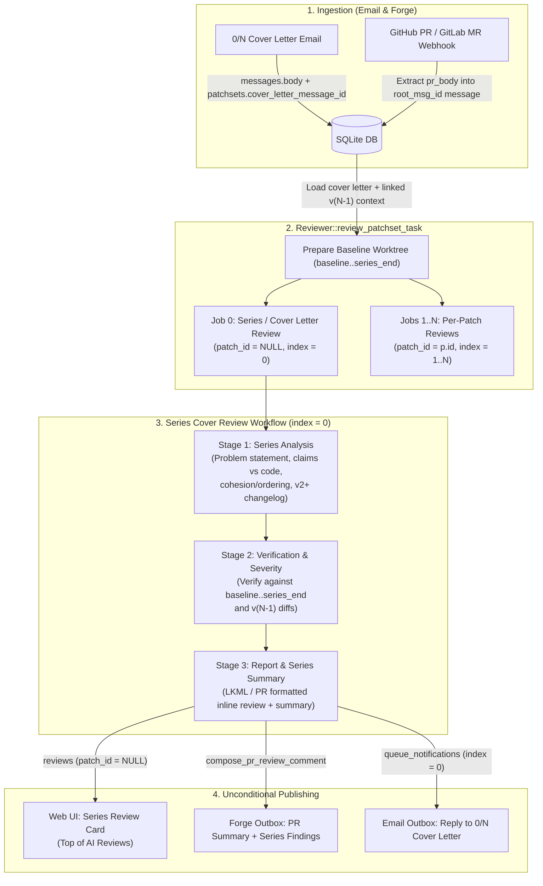

# Design: Series Cover Letter & PR Description Review

## 1. Overview & Motivation

Sashiko currently reviews each commit in a patch series (`part_index >= 1` in the `patches` table) through the multi-stage patch review workflow (`src/workflows/linux_patch_review.rs` and `src/workflows/sashiko_patch_review.rs`), but does not review the series cover letter (`[PATCH 0/N]`) or pull request description as a first-class artifact:

1. **Email cover letters (`0/N`) are ingested but never reviewed:**
   In `parse_email` (`src/patch.rs`), a cover letter has `metadata.index == 0` and `patch == None`. Its text is stored in `messages.body` (referenced by `patchsets.cover_letter_message_id`), and `Reviewer::review_patchset_task` (`src/reviewer.rs`) reads that body only to extract baseline hints (`base-commit:`, `Based-on:`) and prerequisite patch IDs.
2. **Forge PR descriptions are dropped at webhook ingestion:**
   In `GitHubForge::parse_webhook` and `GitLabForge::parse_webhook` (`src/forge.rs`), `ForgeMetadata` extracts `pr_number`, `pr_title`, `pr_url`, `author`, `base_sha`, `head_sha`, and `repo_url`, but ignores `pull_request.body` (GitHub) and `object_attributes.description` (GitLab). When `Fetcher::fetch_git_task` (`src/fetcher.rs`) creates the root message for `<base>..<head>@sashiko.local`, it passes `""` as the message body.
3. **Series-wide requirements cannot be audited by single-patch reviews alone:**
   Whether a series clearly explains the problem it solves, whether its cover letter narrative matches the actual code changes across all patches, whether commits are ordered for bisectability without unrelated drive-by changes, and whether a `v2+` revision includes an accurate changelog and addresses prior version findings are series-level properties.

This design introduces a dedicated **Series / Cover Letter Review** pass (`patch_id = NULL`, `index = 0`) that runs alongside per-patch reviews and publishes its results unconditionally across all three channels: **Web UI**, **Forge PR summary comments**, and **email replies on `0/N` cover letters**.

---

## 2. Linux Kernel Series & PR Review Requirements

The series/cover-letter review evaluates three core dimensions:

### 2.1 Problem Statement & Motivation ("Why", Not Just "What")

Per `Documentation/process/submitting-patches.rst`, a series cover letter (or PR description) must establish why the change is needed:

* **Concrete problem description:** Does the cover letter / PR description explain what problem, bug, limitation, or use case motivates the series?
* **User-visible impact & symptoms:** For bug fixes or performance work, does it describe the user-visible symptoms (crash, hang, memory leak, data corruption, lock contention, benchmark regression) or hardware platform affected?
* **Empty or boilerplate cover letters:** Flag cover letters or PR descriptions that:
  * Are empty or consist only of a subject line when the series is non-trivial (`total_parts > 1`).
  * Leave unfilled tool templates in place (such as `b4`'s `*** BLURB HERE ***` or PR template placeholders).
  * Merely paste `git shortlog` / diffstat or restate what each function change does syntactically without explaining the overall problem or motivation.

### 2.2 Cover Letter / PR Claims vs. Actual Code & Series Cohesion

Using the full commit list (`1/N .. N/N`) and Git worktree tools (`git_diff`, `git_show`, `git_read_files`, `git_grep`):

* **Claims vs. Implementation:** Verify that design decisions, architectural changes, behavioral claims, and scope statements made in the cover letter / PR description are actually implemented by the patches in `baseline_sha..series_end_sha`. Flag contradictions (e.g., cover letter claims a lock is converted to RCU or a fallback path is preserved, when the patches do otherwise).
* **Series Cohesion (Single Logical Purpose):** Verify that all commits in the series belong to the same logical topic. Flag unrelated drive-by fixes, formatting cleanups in unrelated subsystems, or independent features bundled into the same series that should be submitted separately.
* **Commit Ordering & Bisectability:**
  * **No intra-series breakage:** Flag cases where an earlier patch `[Patch i/N]` introduces a broken build, uninitialized state, or regression that a later patch `[Patch j/N]` ($j > i$) fixes instead of keeping every intermediate commit bisectable.
  * **Device Tree bindings ordering:** In Linux kernel series touching both `Documentation/devicetree/bindings/` and driver code, `dt-bindings:` patches must precede the driver patches that reference the new compatible strings or properties.
  * **Preparatory refactoring before functional change:** Complex refactoring or helper extraction should precede the functional change or bug fix rather than being mixed into a single monolithic patch.

### 2.3 Revision Changelog (`v2+`) & Prior Version Verification

When the series version is `v2` or higher (`version > 1`):

* **Changelog presence:** Verify that the cover letter (or the area below `---` for a single-patch series) includes a changelog describing what changed since the previous version(s) (e.g., `Changes in v2:`, `v1 -> v2:`).
  * *Exception:* Forge pull requests (`mr_url IS NOT NULL`) where git push history is tracked on the PR itself do not require a manual `v1 -> v2:` text block in the PR description, though if a previous PR push was reviewed (`previous_patchset_id`), Sashiko still verifies whether prior review findings were addressed.
* **Changelog accuracy vs. inter-version diff (when linked to `v(N-1)`):**
  When Previous Version Linking links this patchset to `previous_patchset_id`:
  * Compare the author's stated `v(N-1) -> vN` changelog against the actual patch lineage (`unchanged`, `modified`, `added`, `removed` patches and inter-version diffs). Flag material discrepancies (e.g., the changelog claims a bug in Patch 3 was fixed, but Patch 3's `git_patch_id` is identical to `v(N-1)`).
  * **Unaddressed findings from `v(N-1)`:** Inspect verified findings (`findings` table with `preexisting = 0`) from the linked `previous_patchset_id`. If a defect reported in `v(N-1)` is still present in `vN` and the author did not address or refute it, report it in the series/patch review citing the prior version.

> [!NOTE]
> Per-commit mechanical trailer checks (`Signed-off-by:`, `Fixes:` SHA length/quoting, etc.) remain scoped to individual commits where applicable and are not duplicated as noisy cover-letter findings.

---

## 3. Architecture & Data Flow



### 3.1 Capturing Forge PR Descriptions (`src/forge.rs`, `src/fetcher.rs`)

1. Add `pub pr_body: Option<String>` to `ForgeMetadata` (`src/forge.rs`):
   * In `GitHubForge::parse_webhook`: extract `pr["body"].as_str().map(str::to_string)`.
   * In `GitLabForge::parse_webhook`: extract `attrs["description"].as_str().map(str::to_string)`.
2. In `Fetcher::fetch_git_task` (`src/fetcher.rs`), when creating the root message for `root_msg_id` (`<base>..<head>@sashiko.local`), pass `forge_meta.as_ref().and_then(|m| m.pr_body.as_deref()).unwrap_or("")` instead of `""` as the `body` argument to `db.create_message(...)`.

### 3.2 When the Series / Cover Letter Review Runs

In the server daemon (`Reviewer::review_patchset_task` in `src/reviewer.rs`), Sashiko schedules a series-level review job (`index = 0`, `patch_id = None`) alongside the `1..N` patch jobs when either:
1. **An explicit cover letter or PR description exists:** `patchset.subject_index == 0`, or `patchset.mr_url.is_some()`, or `cover_letter_message_id` points to a `0/N` message in `messages` with a non-empty body.
2. **The series has multiple patches (`total_parts > 1`):** Even if the author omitted a `0/N` cover letter on a multi-patch series, the series review runs to evaluate series cohesion, commit ordering/bisectability, and (for non-trivial multi-patch series) whether a cover letter explaining the overall architecture was needed.
3. **A previous version is linked (`previous_patchset_id.is_some()`):** Runs to verify `v(N-1) -> vN` changelog accuracy and whether prior findings were addressed.

In local CLI review (`local_review::run_worker_in_worktree` in `src/local_review.rs`), `index = 0` is synthesized automatically when `cover_letter.is_some() || previous_version.is_some()` (such as an mbox or JSON input containing a cover letter or prior-version context) or when `--patch 0` is explicitly requested; pure git commit-range invocations (`sashiko review base..head` without a cover letter) review commits `1..N` directly unless `--patch 0` is passed.

### 3.3 Input Payload & Previous-Version Context (`ReviewInput`)

Extend the JSON payload passed from `Reviewer` (`src/reviewer.rs`) to the worker subprocess (`Worker::run` in `src/worker/prompts.rs`) with optional series cover and previous-version metadata:

```json
{
  "id": 42,
  "message_id": "20261012-foo-v2-0-abcdef@kernel.org",
  "subject": "[PATCH v2 0/3] net: foo: fix race during teardown",
  "version": 2,
  "is_forge_pr": false,
  "cover_letter": {
    "message_id": "20261012-foo-v2-0-abcdef@kernel.org",
    "subject": "[PATCH v2 0/3] net: foo: fix race during teardown",
    "author": "Jane Doe <jane@kernel.org>",
    "date": 1791830000,
    "body": "This series fixes a teardown use-after-free in foo_remove()...\n\nChanges in v2:\n- Hold foo_lock across bar_cleanup() in patch 2 (John)\n"
  },
  "previous_version": {
    "patchset_id": 31,
    "version": 1,
    "subject": "[PATCH 0/3] net: foo: fix race during teardown",
    "cover_body": "This series fixes a teardown use-after-free...",
    "patch_lineage": [
      { "part_index": 1, "prev_part_index": 1, "status": "unchanged" },
      { "part_index": 2, "prev_part_index": 2, "status": "modified", "prev_diff_summary": "..." },
      { "part_index": 3, "prev_part_index": 3, "status": "unchanged" }
    ],
    "previous_findings": [
      {
        "part_index": 2,
        "severity": "High",
        "problem": "net: foo: bar_cleanup() called without foo_lock",
        "severity_explanation": "..."
      }
    ]
  },
  "patches": [ ... ]
}
```

### 3.4 Series / Cover Letter Review Workflow (`patch_index == 0`)

When `patch_index == Some(0)` in `Worker::run` (`src/worker/prompts.rs`):
* `target_commit_sha` is set to the series tip commit (`series_end_sha`), and `baseline_sha` is set to the series base commit.
* `target_commit_diff` contains:
  1. The full cover letter / PR title and body (or a note that no `0/N` cover letter was provided).
  2. The ordered list of commits in the series (`1/N .. N/N`) with each commit's SHA, subject, full commit message, and diffstat (`git show --stat`).
  3. The `previous_version` summary block (when `previous_patchset_id` is linked), including `patch_lineage` and `previous_findings`.
* The workflow runs a streamlined 4-stage pipeline using the same `WorkflowEngine` and `ToolBox` (so the model can call `git_diff`, `git_show`, `git_read_files`, and `git_grep` across `baseline_sha..series_end_sha`):
  1. **`series-analysis` stage** (always runs): Audits problem statement & motivation, cover letter / PR claims vs. actual code across the commits, series cohesion & commit ordering / bisectability (`dt-bindings` ordering, no intra-series regression-then-fix), and `v2+` changelog presence/accuracy + resolution of `previous_findings`. Outputs `concerns` and `dismissed_concerns` with concrete `locations` (using `"file": "cover_letter"` or the specific source file path).
  2. **`verification` & `post-verification` stages**: Reuse the existing verification and tool-assisted post-verification stages to eliminate false positives and calibrate severity (`Low`, `Medium`, `High`, `Critical`).
  3. **`summary` stage**: Produces a concise 2-4 sentence plain-text overview of the entire patch series / PR (populating `reviews.summary` for `patch_id = NULL`).
  4. **`report` stage** (skipped when `findings` is empty): Generates the plain-text LKML reply (for email series) or PR series findings block (for Sashiko/Forge PRs).

---

## 4. Database & Notification Plumbing

### 4.1 Schema Updates (`src/migrations/014_patchset_version_lineage.sql`)

The `reviews` table already supports patchset-level reviews via nullable `patch_id INTEGER` (`001_initial.sql`). However, `email_outbox` currently links only to `patch_id INTEGER` without `patchset_id` or `review_id`, which prevents cancelling or querying outbox rows for a cover-letter review (`patch_id = NULL`).

We add `patchset_id` and `review_id` to `email_outbox`:

```sql
ALTER TABLE email_outbox ADD COLUMN patchset_id INTEGER REFERENCES patchsets(id);
ALTER TABLE email_outbox ADD COLUMN review_id INTEGER REFERENCES reviews(id);

CREATE INDEX IF NOT EXISTS idx_email_outbox_patchset_id
    ON email_outbox(patchset_id);
```

### 4.2 Database Query Updates (`src/db.rs`)

1. **Counting & claiming patchset-level reviews:**
   * Add `Option<i64>` support (`patch_id: Option<i64>`) to `count_successful_reviews` and `has_failed_review` using `patch_id IS ?` so `None` matches `patch_id IS NULL`.
2. **Releasing completed reviews (`get_completed_reviews_for_release`):**
   * Update `get_completed_reviews_for_release` from `JOIN patches p ON r.patch_id = p.id` to:
     ```sql
     SELECT r.id, r.patch_id, r.inline_review, r.summary,
            COALESCE(p.message_id, ps.cover_letter_message_id),
            COALESCE(p.part_index, 0)
     FROM reviews r
     JOIN patchsets ps ON r.patchset_id = ps.id
     LEFT JOIN patches p ON r.patch_id = p.id
     WHERE r.patchset_id = ? AND r.status = 'Reviewed'
     ORDER BY COALESCE(p.part_index, 0) ASC, r.id ASC
     ```
   * Change `ReleaseReview.patch_id` from `i64` to `Option<i64>`.
3. **Outbox deduplication & cancellation (`insert_email_outbox`, `cancel_outbox_for_patchset`, `lock_pending_email`):**
   * `insert_email_outbox` accepts `patchset_id: Option<i64>`, `patch_id: Option<i64>`, `review_id: Option<i64>`. Deduplication checks `WHERE (patch_id IS NOT NULL AND patch_id = ?) OR (patch_id IS NULL AND patchset_id IS NOT NULL AND patchset_id = ? AND kind = 'review_reply')`.
   * `cancel_outbox_for_patchset` and `lock_pending_email` cancel rows where `patchset_id = ? OR patch_id IN (SELECT id FROM patches WHERE patchset_id = ?)`.
4. **Patchset details API (`get_patchset_details` and `get_patchset_summary`):**
   * Include the cover letter's `email_status`, `email_to`, and `email_cc` (from `email_outbox WHERE patchset_id = ? AND patch_id IS NULL`) on the `patch_id = NULL` review object returned in `reviews`.

### 4.3 Publishing Across All Three Channels

1. **Web UI (`static/index.html`):**
   * `get_patchset_details` already selects `WHERE r.patchset_id = ? AND (r.patch_id IS NULL OR r.patch_id IN (...))`.
   * In `renderPatchsetView`, render any review with `r.patch_id === null` at the top of `#ai-reviews` under a **Cover Letter / Series Review** header (linking to `#/message/<cover_letter_message_id>` when a `0/N` message exists), complete with its `Summary`, `Inline Review` (expanded automatically when findings exist), `Email Status`, `View Review Map`, and `View Raw Log`.
2. **Forge PR Comment (`src/reviewer.rs`, `src/forge.rs`):**
   * In `queue_forge_pr_comment`, look up the `r.patch_id.is_none()` review from `reviews`:
     * Use its `r.summary` as `series_summary`.
     * Pass its `inline_review` (if non-empty and not `"No issues found."`) as `series_inline_review: Option<&str>` to `compose_pr_review_comment`.
   * In `compose_pr_review_comment`, when `series_inline_review` is `Some(...)`, render a `### Series / PR Review` block immediately after `### Series Summary` and before the per-commit breakdown.
3. **Email Reply on `0/N` Cover Letter (`src/reviewer.rs`):**
   * When `index == 0` (`patch_id == None`) completes review and `patchset_message_id` is a real email Message-ID (not ending with `@sashiko.local` and not a 40-hex commit SHA):
     * Call `queue_notifications` with `patch_id = None`, `index = 0`, `patch_message_id = patchset_message_id`.
     * `queue_notifications` resolves the `0/N` message from `messages`, applies the same bot-loop guard, `EmailRouter::resolve_recipients` / `resolve_positive_recipients`, and embargo rules as patch emails, and inserts a reply `In-Reply-To: <cover_letter_message_id>` with target URL `https://<domain>/#/patchset/<cover_letter_message_id>?part=0`.
   * Local CLI (`sashiko review`): When `cover_letter` or `previous_version` is present in the review input or `--patch 0` is requested, synthesizes and displays the series/cover-letter review (`index = 0`) alongside per-commit reviews in both human terminal output and `--agent` / `--json` output.

---

## 5. Risks & Mitigations

1. **Duplicate Findings Between Cover Letter Review and Patch Reviews:**
   * **Risk:** The series review (`index = 0`) might inspect code in Patch 2 and report the same local C/Rust bug (e.g., a null pointer dereference) that Patch 2's review (`index = 2`) reports, resulting in duplicate emails on `0/N` and `2/N`.
   * **Mitigation:** Strictly scope the `series-analysis` stage prompt: it is **forbidden** from reporting local implementation bugs within a single patch that do not involve the cover letter narrative, cross-patch ordering/bisectability, series cohesion, or `v2+` changelog/prior-review accuracy. Any single-patch code bug belongs exclusively to that patch's review unless the cover letter explicitly makes a false claim about it or a `v(N-1)` finding went unaddressed.
2. **Missing `0/N` Cover Letter on Trivial 2-Patch Series:**
   * **Risk:** Flagging every 2-patch series without a `0/2` cover letter as an issue would be noisy when the two patches are self-explanatory.
   * **Mitigation:** Only flag a missing `0/N` cover letter when the series is complex (`total_parts >= 3` or cross-subsystem) and the motivation/architecture cannot be understood from the patch subjects alone.
3. **Embargo & Outbox Cancellation Consistency:**
   * **Risk:** A cover-letter review email with `patch_id = NULL` could escape `cancel_outbox_for_patchset` or `CLEAN_PATCHSET_PREDICATE` if those queries only inspect `patch_id IN (SELECT id FROM patches ...)`.
   * **Mitigation:** Adding `patchset_id` to `email_outbox` and checking `r.patchset_id = p.id` in `CLEAN_PATCHSET_PREDICATE` ensures that a cover-letter finding holds the patchset under embargo and is cancelled on superseding identically to a patch finding.
