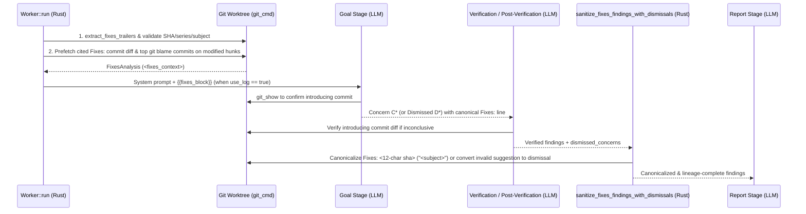

# Design: `Signed-off-by:` and `Fixes:` Trailer Verification

## 1. Problem Statement & Goals

Across DCO-governed workflows (`linux`, `sashiko`, `qemu`, `zephyr`), every commit must carry a valid Developer's Certificate of Origin (`Signed-off-by: Real Name <email>`) trailer. In `linux`, `sashiko`, and `qemu`, bug-fix commits also carry a `Fixes:` trailer identifying the commit that introduced the defect:

```text
Fixes: <12-char sha> ("<subject>")
Signed-off-by: Real Name <email>
```

Reviewers check three properties on every patch in the `goal` stage:
1. **Verify `Signed-off-by:` presence and real-name correctness (`High` severity)**: Is at least one `Signed-off-by:` trailer present, and does every `Signed-off-by:` line carry a real human name (not empty, not a placeholder such as `Your Name`, not an AI/bot identity, and not a handle/username) and a syntactically valid, routable `<email>` address? Missing or clearly broken `Signed-off-by:` trailers block patch acceptance under DCO rules and are reported at `High` severity (`"preexisting": false`).
2. **Verify existing `Fixes:` tags (`Low` severity)**: Is the syntax canonical? Does the SHA exist in the repository (including fetched maintainer trees) and not point to an unmerged patch in the same series? Does the quoted subject match the commit's actual subject? And **semantically**, did that commit actually introduce the bug being fixed?
3. **Suggest missing `Fixes:` tags (`Low` severity)**: When a commit fixes a concrete bug without a `Fixes:` tag, can the specific commit in repository history that introduced the broken logic be identified with high confidence?

### Project Scope
- **`Signed-off-by:` Audit Enabled**: `linux`, `sashiko`, `qemu`, `zephyr`.
- **`Fixes:` Audit Enabled**: `linux`, `sashiko`, `qemu`.
- **Disabled**: `gcc` (GCC accepts commits under FSF copyright assignment without DCO `Signed-off-by:` and uses GNU ChangeLog blocks and Bugzilla `PR <component>/<number>` tags rather than `Fixes: <sha> ("<subject>")` trailers).

### Design Goals
- **Deterministic DCO Pre-Classification**: Pre-parse `Signed-off-by:` trailers (and common tag-prefix typos such as `Sign-off-by:`) in Rust, classifying missing trailers, missing/malformed/placeholder/localhost/LLM-noreply emails, placeholder names, AI/bot names, and obvious handles (`user_123`, lowercase username matching email local-part) as `CLEARLY BROKEN`, capitalized single-word names as `SUSPECT` (so legal mononyms can be distinguished from handles by context), and normal multi-word human names (including human names such as `Claude Shannon` or `Ai Chao`) as `SYNTAX VALID`.
- **Zero Hallucinated SHAs or Subjects**: Never suggest or "correct" a `Fixes:` tag with an invented SHA, wrong SHA length, or paraphrased subject line.
- **Maintainer-Tree Awareness**: A `Fixes:` SHA may reside in a maintainer branch rather than mainline (`Baseline SHA`). Resolve SHAs across the entire repository git object database (`<sha>^{commit}`), search `git log --all --fixed-strings --grep=<subject>` when a SHA is not directly found, and report completely unknown SHAs at `Low` severity.
- **High Precision / Benchmark Safety**: Never demand `Fixes:` tags on new features, refactorings, cleanups, documentation, hardware enablement, or ambiguous historical evolution; never flag missing `Signed-off-by:` on headerless raw diffs that carry no commit message.
- **Minimal Tool-Turn Overhead**: Pre-compute deterministic trailer checks and hunk `git blame` candidates in Rust so LLM stages do not burn extra tool turns on routine commits.
- **Lineage Integrity (`review_map`)**: Preserve 100% concern lineage accounting (`source_ids`) when the post-verification Rust guard filters out an invalid `Fixes:` suggestion or normalizes trailer severities.

---

## 2. Architecture: Hybrid Deterministic Git Pre-Analysis + Workflow Integration + Rust Guard



---

## 3. Component Design

### 3.1 Deterministic Pre-Analysis (`src/worker/fixes_check.rs`)

Executed during `Worker::run` (`src/worker/prompts.rs`) when `worktree_path` is available and stored in `state.fixes_analysis: FixesAnalysis`:

- **Core Types**:
  - `FixesAnalysis`: holds `prompt_context: String`, `author_fixes_shas: Vec<String>`, `author_fixes_raw: Vec<String>`, `series_commit_shas: Vec<String>`, and `known_commits: Vec<ResolvedFixesCommit>`.
  - `ResolvedFixesCommit`: holds `full_sha`, `abbrev_sha`, `commit_date`, and `subject` (with `canonical_trailer()` and `matches_sha()`).
  - `ParsedFixesTrailer`: holds `raw`, `tag_prefix`, `is_multiline`, and `kind: FixesTrailerKind`.
  - `FixesTrailerKind`:
    - `BugTrackerId(String)`: valid Sashiko `<project>-<uuid>` bug reference when `project == ProjectId::Sashiko`.
    - `Url(String)`: external URL misplaced in a `Fixes:` trailer.
    - `CommitRef { sha_token, subject, canonical_parens_quotes, exact_single_space_before_paren }`: commit SHA reference with optional quoted subject and formatting flags.
    - `Malformed(String)`: unparseable trailer value in the commit trailer block.
  - `HunkBlameTarget` & `BlameCandidate`: `extract_diff_blame_targets` collects modified files and pre-image line ranges; `collect_blame_candidates_async` runs `git blame --porcelain -L <start>,<end> <parent_rev> -- <file>` and ranks the top 5 historical commits (`BlameCandidate { commit, score, touched_summary }`), excluding `INITIAL_KERNEL_ROOT_SHA` (`1da177e4c3f415667457b932fe38c6f7471e1a58`) and `series_commit_shas`.

### 3.2 Prompt Injection & Stage Instructions

- `render_fixes_block(use_log, &state.fixes_analysis)` is injected via `{{fixes_block}}` into `linux_system_prompt`, `sashiko_system_prompt`, `qemu_system_prompt`, and `zephyr_system_prompt` whenever `use_log == true` (for `zephyr`, `<fixes_context>` carries the deterministic `Signed-off-by:` trailer section without `Fixes:` hunk blame).
- `STAGE_GOAL_INSTRUCTION`, `STAGE_VERIFICATION_INSTRUCTION`, and `STAGE_POST_VERIFICATION_INSTRUCTION` in `src/workflows/{linux,sashiko,qemu,zephyr}_patch_review.rs` (along with project prompt guides under `projects/{linux,sashiko,qemu,zephyr}/prompts/`) instruct the workflow to:
  1. Audit `Signed-off-by:` presence, real human name, and routable `<email>` in the `goal` stage, raising a separate `High` severity concern (`"preexisting": false`) on `"commit_message"` whenever `Signed-off-by:` is missing or clearly broken (never merged with `Fixes:` concerns).
  2. Audit all deterministic `Fixes:` statuses in `<fixes_context>` and verify `SYNTAX & SHA VALID` commits with `git_show`.
  3. Report unknown `Fixes:` SHAs at `Low` severity noting the commit may reside in an unindexed maintainer tree or contain a typo.
  4. Suggest a missing `Fixes: <12-char sha> ("<subject>")` at `Low` severity (`"preexisting": false`) on genuine bug fixes only when `git_show` on the candidate commit proves it introduced the defect.
  5. Dismiss `Fixes:` suggestions on non-bugfix commits (features, refactorings, cleanups, docs, tests, style/warning fixes) or pointing to same-series commits.

### 3.3 Post-Verification Canonicalizer & Lineage Guard

`sanitize_fixes_findings_with_dismissals` runs inside `enrich_verification_output_for_stage` and `apply_post_verification_stage_output` (`src/workflows/linux_patch_review.rs`) before `VD*`/`VF*`/`PVD*`/`PVF*` IDs are assigned:
- Canonicalizes any valid `Fixes: <sha> ("<subject>")` suggestion in `findings` to the exact 12-char SHA and subject from git (`Fixes: <abbrev_sha> ("<subject>")`) while keeping bare `Fixes: <sha>` references in short `problem` titles concise (`Fixes: <abbrev_sha>`) and preserving verbatim quotes of the author's own trailer (`author_fixes_raw`).
- Enforces `"severity": "Low"` and `"preexisting": false` on `Fixes:` trailer findings (`is_fixes_trailer_finding`), and enforces `"severity": "High"` and `"preexisting": false` on `Signed-off-by:` findings (`is_signed_off_by_finding`) while keeping `Assisted-by:` / `Fixes:` findings distinct.
- Rejects any `Fixes:` suggestion whose suggested SHA is unresolvable in the repository or belongs to `series_commit_shas` (unless it is the author's own `Fixes:` SHA being reported as invalid), converting the rejected finding into a dismissal in `dismissed_concerns` with its `source_ids` and `locations` intact so `review_map` lineage accounting remains complete.
