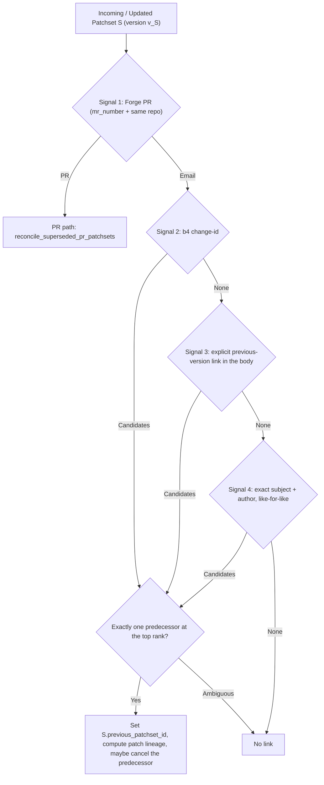

# Design: Finding and Linking Previous Versions of a Patch / Series

## 1. Overview & Motivation

Linux kernel patch series and Forge pull requests frequently go through multiple revisions (`v1`, `v2`, `v3`, ...) before being merged. Currently, Sashiko has partial, ephemeral superseding logic in `src/db.rs`:

1. **No persisted version links:**
   `reconcile_superseded_pr_patchsets` and `reconcile_superseded_series_patchsets` cancel older in-flight patchsets when a newer version arrives, and `rotate_mr_slug` renames old PR slugs to `<slug>-v<N>`, but neither records a link between `v1` and `v2` in SQLite. Once `v1` is `Reviewed` (or `Cancelled`), there is no link in the database, API, or Web UI connecting `v1`, `v2`, and `v3`.
2. **`reconcile_superseded_series_patchsets` ignores already-completed patchsets:**
   The query in `reconcile_superseded_series_patchsets` filters on `status IN ('Fetching', 'Incomplete', 'Pending', 'In Review')`. Because `v1` is almost always `Reviewed` days before `v2` is posted, `v2` never matches `v1`.
3. **Subject-only matching misses renamed series and ignores rich signals:**
   Authors often refine the cover letter subject between `v1` and `v2`, or send a 1-patch `v1` that becomes a 2-patch `v2` series. Meanwhile, emails carry explicit signals that Sashiko already parses or can extract locally without network requests:
   * `b4` `change-id:` footers (`change-id: 20261001-foo-fix-8a9b1c2d3e4f`).
   * Explicit previous-version Lore links in the cover letter or below `---` (`v1: https://lore.kernel.org/all/<msgid>/`, b4's `- Link to v1: https://lore.kernel.org/r/<msgid>`).
   * Stable Git patch IDs (`patches.git_patch_id` from `012_git_patch_id.sql`) shared by unchanged patches across versions, used to map individual patches once two series are linked.
4. **No patch-level lineage across versions:**
   Reviewers in the Web UI cannot see which patches in `v2` are unchanged from `v1`, which were modified, and which are newly added.

This design introduces **local, multi-signal version discovery and linking** at both the **patchset level** (`v1 -> v2 -> v3`) and the **individual patch level** (`v1 Patch i <-> v2 Patch j`), integrated into ingestion, the REST API, and the Web UI.

**Precision over recall.** A wrong link is worse than a missing one: it mislabels the UI, maps patches of unrelated series onto each other, and can cancel the review of a patchset that was never superseded. Every rule below therefore prefers linking nothing over guessing. A missed link only loses a convenience; the patchset is still reviewed on its own.

---

## 2. Series-Level Version Discovery Signals

When a patchset $S$ is created or receives a new part (`Database::create_patchset`, `create_patch_with_git_patch_id`, `set_patchset_change_id_if_unset`), Sashiko looks for **the one patchset that $S$ is the next version of**. All signals operate strictly against the local SQLite database (no external Lore HTTP requests).



### 2.1 Invariants (apply to every email signal)

1. **Backwards only.** Only $S$ itself is linked: `S.previous_patchset_id` and `S.version_link_signal` are the only lineage columns written (plus `S.version` and `S.change_id`). No other patchset's `previous_patchset_id` is ever written, no version family is expanded or renumbered, and a later run can only change $S$'s own link.
2. **Strict predecessor.** A candidate $C$ qualifies only if
   * `C.date < S.date` (strictly older),
   * `C.version < S.version` (strictly lower; an unversioned `[PATCH]` is version 1),
   * $C$ and $S$ have the same author email (`extract_email`, exact match or the b4 web relay `devnull+` alias of the same address via `authors_match`). A display name alone never matches, and authors without an email address never match,
   * $C$ is not a placeholder or a reply, is not a Forge PR, and is not a prerequisite of $S$ (or $S$ a prerequisite of $C$) according to `Based-on:` / `prerequisite-message-id:` / `prerequisite-patch-id:` trailers.
3. **One predecessor or none.** The highest-ranked signal that yields at least one qualifying candidate decides. Within that signal, the candidate with the highest version wins. If two *different* candidates share that highest version and the signal cannot prove they are the same series (Signal 3), nothing is linked and the ambiguity is logged at info level. Lower-ranked signals are not consulted after an ambiguous result.
4. **Recomputed on every run.** The predecessor is recomputed from scratch whenever $S$ is reconciled (cover letter, patch 1, final patch, change-id update). A newly chosen predecessor replaces the existing link. When no signal yields a predecessor, an existing link is kept only while it still satisfies invariant 2 (for example a link carried over when two partial rows of the series were merged); otherwise (for example a cover letter arrived later and names the old predecessor as a prerequisite) the link and the per-patch lineage of $S$ are cleared.
5. **Out-of-order arrival.** If `v1` is ingested after `v2`, `v1` finds no older, lower-versioned predecessor and `v2` is not touched. The `v1 -> v2` link is only made if `v2` is reconciled again later (for example when its last part arrives). This miss is accepted.

### Signal 1: Forge PR / MR Identity (`mr_number` + Repository)
* **Trigger:** `S.mr_number IS NOT NULL`.
* **Behaviour:** Unchanged; handled by `reconcile_superseded_pr_patchsets`, which links all revisions of the same PR in the same repository and cancels older in-flight revisions.
* **Confidence:** Exact (`"forge_mr"`).

### Signal 2: `b4` `change-id:` Trailer & `b4 prep` Tracker Commits
* **Extraction:** Parse `change-id: <token>` (case-insensitive header/trailer line in the cover letter body or below `---` in patch `1/N`, e.g., `change-id: 20260920-net-foo-teardown-4f2a9c1b`) or `"change-id"` from an un-sent `b4 prep` tracking block (`--- b4-submit-tracking ---`) via `parse_b4_change_id(body: &str) -> Option<String>` in `src/patch.rs`. When reviewing a git branch range containing an empty `b4 prep` tracker commit (`parse_b4_submit_tracking`), filter the tracker commit out of the `1..N` patch list and extract its `change-id`. Store in `patchsets.change_id` (indexed).
* **Match criteria:** `C.change_id == S.change_id` plus the invariants in 2.1.
* **Choice:** Highest version; same-version duplicates (resends) are the same series by construction, so the latest one wins.
* **Confidence:** Exact (`"change_id"`). Survives cover letter subject renames and patch count changes.

### Signal 3: Explicit Previous-Version Links in the Body
* **Extraction:** `extract_version_reference_msgids(body)` in `src/patch.rs` scans the cover letter body and the patch `1/N` body (up to the first diff) line by line. A line counts only if it **starts with** an explicit previous-version marker and the link follows **on the same line**:
  * `v1: <url>`, `- v1: <url>`, `* v1: <url>`, `[v1] <url>`, `v1 link: <url>`, `v1 (<url>)`, `v7 (with test steps): <url>`;
  * b4's `- Link to v1: <url>`, `Link to v1: <url>`, `Link[v1]: <url>`;
  * `Previous version: <url>`, `Previous revision: <url>`, `Version 1: <url>`;
  * `Changes since v1 (<url>):`, `Changes since v1: <url>`.

  The link is a Lore / LKML / Patchwork / `patch.msgid.link` URL or a bare `<message-id>`.
* **Not counted:**
  * `In-Reply-To` / `References` headers. A series posted as a reply into a discussion thread would otherwise be linked to whatever the thread was about.
  * Links on lines below a changelog heading (`Changes in v3:`) that carry no version marker of their own, such as `Link:` trailers, `[1] <url>` footnotes, or dependency links.
  * Kernel-version prose (`since v6.8`, `in v6.12`, `fixed in v5.4`, `v6.8: <url>`).
  * Quoted lines and dependency or bug-report trailers (`Based-on:`, `prerequisite-message-id:`, `base-commit:`, `Closes:`, `Fixes:`, `Reported-by:`, `BugLink:`).
* **Match criteria:** Look up the local patchsets whose `cover_letter_message_id` or a `patches.message_id` matches one of the extracted Message-IDs, plus the invariants in 2.1.
* **Choice:** Highest version. Two different patchsets at that version are ambiguous and produce no link.
* **Confidence:** High (`"message_ref"`).

### Signal 4: Exact Cleaned Subject + Author, Like-for-Like
* **Trigger:** `S.version > 1`, the cleaned subject is not empty, and it is not a generic short subject (`fix typo`, `cleanup`, ...) without subsystem prefixes.
* **Candidates:** Local patchsets by the same normalized author email dated in `[S.date - 120 days, S.date)` (no forward window), via the expression index `idx_patchsets_author_email_date` (`ORDER BY date DESC LIMIT 100`), across all statuses.
* **Match criteria:**
  1. `clean_subject(C.subject) == clean_subject(S.subject)` **and** `get_subject_prefixes(C.subject) == get_subject_prefixes(S.subject)` (exact match, no fuzzy or per-patch matching).
  2. Like-for-like shape only: a cover letter (`subject_index == 0`) is compared only with a cover letter, and a single patch (`subject_index == 1`, `total_parts == 1`) only with a single patch. Patch 1 of a series is never compared with a cover letter, and a single patch split out of an earlier series is not linked to that series.
  3. The invariants in 2.1.
* **Choice:** Highest version; same-version duplicates share the exact subject and are resends of the same series, so the latest one wins.
* **Confidence:** Medium-High (`"subject_author"`).

### Removed: `git_patch_id` Overlap Across Series
Sharing one unchanged patch is not evidence that two series are versions of each other. In practice it usually means one series carries a dependency or a cherry-picked patch of another (for example three different CAN series by the same author chained through one shared patch). `git_patch_id` is therefore **not** a series-linking signal. It is still used by the per-patch lineage (Section 3) once two series are linked by one of the signals above.

### 2.2 Superseding (Cancelling the Predecessor)

When $S$ gets a **new** link to predecessor $P$ (the link did not exist before this run), $P$ is cancelled together with its pending outbox entries if all of the following hold:
* $P$ is still in flight (`Fetching`, `Incomplete`, `Pending`, `In Review`);
* the link came from Signal 2 (`change_id`) or Signal 3 (`message_ref`), or from Signal 4 (`subject_author`) with `S.date - P.date <= 30 days` (the window the pre-lineage superseding logic used).

Nothing else is cancelled: not $P$'s own predecessors, not other members of a chain, not $S$ itself when an older version arrives late, and not $P$ again when a later run of $S$ keeps the same link (so an explicit rerun of $P$ is respected). The Forge PR path keeps its own superseding rules.

---

## 3. Patch-Level Lineage Matching (`v(N-1)` <-> `vN`)

Whenever patchset $S_k$ has a linked `previous_patchset_id` $= S_{k-1}$, Sashiko computes the mapping from each patch $P \in S_k$ (`part_index >= 1`) to its predecessor patch $P_{\text{prev}} \in S_{k-1}$ (`reconcile_patch_lineage(prev_patchset_id, curr_patchset_id)`):

1. **Tier 1 — Exact `git_patch_id` Match (`previous_patch_status = 'unchanged'`):**
   * For each patch $P \in S_k$ with a non-null `git_patch_id`, if an unmatched patch $P_{\text{prev}} \in S_{k-1}$ has the identical `git_patch_id` (breaking ties by identical `clean_subject`, then closest `part_index`), link `P.previous_patch_id = Some(P_prev.id)` and `P.previous_patch_status = Some("unchanged")`.
2. **Tier 2 — Cleaned Subject Match (`previous_patch_status = 'modified'`):**
   * For each remaining unmatched patch $P \in S_k$, if an unmatched patch $P_{\text{prev}} \in S_{k-1}$ has `clean_subject(&P.subject) == clean_subject(&P_prev.subject)` (and non-empty cleaned subject), link `P.previous_patch_id = Some(P_prev.id)` and `P.previous_patch_status = Some("modified")`.
3. **Tier 3 — Singleton Fallback (`previous_patch_status = 'modified'`):**
   * If both $S_{k-1}$ and $S_k$ are single-patch series (`total_parts == 1`) linked via Signal 1, 2, or 3 and their single patches did not match in Tier 1 or 2, link `P_1.previous_patch_id = Some(P_prev_1.id)` with status `"modified"`.
4. **Unmatched Patches:**
   * Any remaining patch in $S_k$ has `previous_patch_id = NULL` and `previous_patch_status = NULL` (treated as newly `"added"` in $S_k$).
   * Any patch in $S_{k-1}$ not referenced by any patch in $S_k$ is treated as `"removed"` in $S_k$.

---

## 4. Database Schema & Invariants

### 4.1 Migration (`src/migrations/014_patchset_version_lineage.sql`)

```sql
-- Series-level version and lineage columns on patchsets
ALTER TABLE patchsets ADD COLUMN version INTEGER;
ALTER TABLE patchsets ADD COLUMN change_id TEXT;
ALTER TABLE patchsets ADD COLUMN previous_patchset_id INTEGER REFERENCES patchsets(id);
ALTER TABLE patchsets ADD COLUMN version_link_signal TEXT;

CREATE INDEX IF NOT EXISTS idx_patchsets_change_id
    ON patchsets(change_id) WHERE change_id IS NOT NULL;

CREATE INDEX IF NOT EXISTS idx_patchsets_previous_patchset_id
    ON patchsets(previous_patchset_id) WHERE previous_patchset_id IS NOT NULL;

CREATE INDEX IF NOT EXISTS idx_patchsets_author_email_date
    ON patchsets(
        LOWER(TRIM(
            CASE
                WHEN INSTR(author, '<') > 0 AND INSTR(author, '>') > INSTR(author, '<')
                THEN SUBSTR(author, INSTR(author, '<') + 1, INSTR(author, '>') - INSTR(author, '<') - 1)
                ELSE author
            END
        )),
        date DESC
    );

-- Patch-level lineage columns on patches
ALTER TABLE patches ADD COLUMN previous_patch_id INTEGER REFERENCES patches(id);
ALTER TABLE patches ADD COLUMN previous_patch_status TEXT;

CREATE INDEX IF NOT EXISTS idx_patches_previous_patch_id
    ON patches(previous_patch_id) WHERE previous_patch_id IS NOT NULL;
```

### 4.2 Out-of-Order Ingestion & Chain Maintenance

In email/NNTP ingestion and lore backfills, versions can arrive out of order (e.g., `v3` is ingested first, then `v1`, then `v2`, or parts of `v2` arrive one by one):

* Whenever a patchset $S$ is created or receives a new part (`create_patchset` / `create_patch_with_git_patch_id` / `set_patchset_change_id_if_unset`), `reconcile_version_lineage(patchset_id)` recomputes $S$'s single predecessor as described in Section 2 and writes only $S$'s own row. Intermediate parts (`1 < received_parts < total_parts`) are skipped; the cover letter, patch 1, and the final part reconcile.
* Because only backward links from the patchset being reconciled are written, a late `v1` never re-stitches an existing chain. A chain is the set of patchsets reachable through `previous_patchset_id` in either direction (see `get_patchset_version_chain`); it may contain gaps, which is acceptable.
* When a link is set, `reconcile_patch_lineage(P.id, S.id)` maps the individual patches. When a link is cleared or changed, the patch-level lineage of $S$ is cleared or recomputed with it.
* **Patchset merge safety (`create_patchset_inner`):** When two partial patchset rows for the *same* version are merged into `target_id`, update any `patchsets.previous_patchset_id` referencing `merge_from_id` to `target_id` and any `patches.previous_patch_id` referencing a merged patch before deleting `merge_from_id`, preserving foreign-key integrity.

---

## 5. REST API & Web UI Integration

### 5.1 `/api/patchset` Response Additions (`get_patchset_details` & `get_patchset_summary`)

1. **`versions` array on the patchset object:**
   Walk the connected version chain (`previous_patchset_id` backwards and forwards, bounded to 32 hops) and return an ordered `versions` list:
   ```json
   "version": 2,
   "previous_patchset_id": 101,
   "versions": [
     {
       "id": 101,
       "version": 1,
       "subject": "[PATCH 0/3] net: foo: fix race during teardown",
       "status": "Reviewed",
       "date": 1791700000,
       "message_id": "20261010-foo-v1-0-111111@kernel.org",
       "slug": null
     },
     {
       "id": 142,
       "version": 2,
       "subject": "[PATCH v2 0/3] net: foo: fix race during teardown",
       "status": "Reviewed",
       "date": 1791830000,
       "message_id": "20261012-foo-v2-0-abcdef@kernel.org",
       "slug": null
     }
   ]
   ```
2. **Per-patch `previous_patch` metadata in `patches[]`:**
   Join `LEFT JOIN patches prev_p ON p.previous_patch_id = prev_p.id LEFT JOIN patchsets prev_ps ON prev_p.patchset_id = prev_ps.id` in `get_patchset_details` and `get_patchset_summary`:
   ```json
   {
     "id": 502,
     "part_index": 2,
     "subject": "[PATCH v2 2/3] net: foo: hold foo_lock in bar_cleanup",
     "previous_patch": {
       "id": 402,
       "patchset_id": 101,
       "patchset_message_id": "20261010-foo-v1-0-111111@kernel.org",
       "part_index": 2,
       "version": 1,
       "status": "modified"
     }
   }
   ```

### 5.2 Web UI (`static/index.html`)

1. **Patchset Header / Metadata Card (`renderPatchsetView`):**
   * When `data.versions && data.versions.length > 1`, display a **Versions:** row in the metadata section showing pill links for every revision in order:
     `v1 (Reviewed)` -> **`v2 (Current)`** -> `v3 (In Review)`.
   * Clicking any version pill navigates directly to `#/patchset/<slug_or_message_id_or_id>`.
2. **Per-Patch Cards (`renderPatchsetView`):**
   * When a patch has `p.previous_patch`, display a subtle badge next to the patch header:
     * `v1 Patch 2 (unchanged)` or `v1 Patch 2 (modified)` linking to `#/patchset/<prev_patchset>?part=<prev_part_index>`.

---

## 6. Risks & Mitigations

1. **False-Positive Linking of Unrelated Series by the Same Author:**
   * **Risk:** An author sends many single-patch cleanups with generic subjects (e.g., `[PATCH] treewide: fix typo`), posts a series that depends on another of their series, carries a shared patch in several series, or posts a new series as a reply into an older thread.
   * **Mitigation:**
     * Only explicit signals link: an exact b4 change-id, an explicit previous-version link on the same line, or an exact like-for-like subject. Threading headers, unmarked Lore links, shared `git_patch_id`s, and patch-1-versus-cover subject matches never link.
     * Require a strictly older, strictly lower-versioned predecessor by the same author email, so a newer series can never become the "previous version" of an older one.
     * Link nothing when the top signal yields two different candidates.
     * Exclude generic 1-2 word subjects (e.g., `"fix typo"`, `"cleanup"`) from Signal 4 unless accompanied by subsystem prefixes (`get_subject_prefixes`).
     * Exclude any patchset named in the current series' `Based-on:` / `prerequisite-*` trailers (and vice versa) from every signal.
   * **Blast radius:** A wrong link affects only the one patchset being reconciled, and cancellation reaches only its direct predecessor under the stricter conditions of Section 2.2.
2. **Cycles in `previous_patchset_id`:**
   * **Risk:** Inconsistent version numbers or dates could create a cycle when walking `previous_patchset_id`.
   * **Mitigation:** Every email link points to a patchset that is strictly older and strictly lower-versioned, so edges cannot form a cycle. Traversal queries additionally track a `HashSet<i64>` of visited IDs with a hard cap of 32 hops.
3. **Query Scaling on `patchsets` and `patches`:**
   * **Risk:** Scanning `patchsets` or `patches` during ingestion on a large database could slow down message ingestion.
   * **Mitigation:** Every lookup path is backed by a selective index (`idx_patchsets_mr_number`, `idx_patchsets_change_id`, `idx_patchsets_cover_letter_message_id`, `idx_patches_message_id`, and `idx_patchsets_author_email_date` with a 120-day backward window and `LIMIT 100`). Very busy senders may have more than 100 patchsets in the window; older candidates are then missed, which only loses links. We also verify index usage via `EXPLAIN QUERY PLAN` tests in `src/db.rs`.
