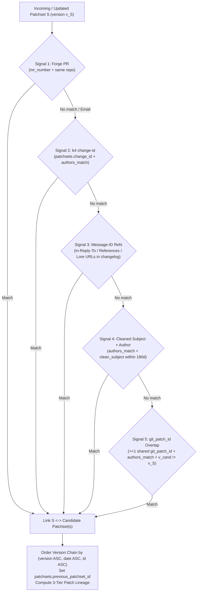

# Design: Finding and Linking Previous Versions of a Patch / Series

## 1. Overview & Motivation

Linux kernel patch series and Forge pull requests frequently go through multiple revisions (`v1`, `v2`, `v3`, ...) before being merged. Currently, Sashiko has partial, ephemeral superseding logic in `src/db.rs`:

1. **No persisted version links:**
   `reconcile_superseded_pr_patchsets` and `reconcile_superseded_series_patchsets` cancel older in-flight patchsets when a newer version arrives, and `rotate_mr_slug` renames old PR slugs to `<slug>-v<N>`, but neither records a link between `v1` and `v2` in SQLite. Once `v1` is `Reviewed` (or `Cancelled`), there is no link in the database, API, or Web UI connecting `v1`, `v2`, and `v3`.
2. **`reconcile_superseded_series_patchsets` ignores already-completed patchsets:**
   The query in `reconcile_superseded_series_patchsets` filters on `status IN ('Fetching', 'Incomplete', 'Pending', 'In Review')`. Because `v1` is almost always `Reviewed` days before `v2` is posted, `v2` never matches `v1`.
3. **Subject-only matching misses renamed series and ignores rich signals:**
   Authors often refine the cover letter subject between `v1` and `v2`, or send a 1-patch `v1` that becomes a 2-patch `v2` series. Meanwhile, emails carry explicit signals that Sashiko already parses or can extract locally without network requests:
   * `b4` `change-id:` footers (`change-id: 20261001-foo-fix-8a9b1c2d3e4f`).
   * Email threading headers (`In-Reply-To` and `References`) when `v2` is posted in reply to `v1`.
   * Explicit Lore links in the cover letter or below `---` (`v1: https://lore.kernel.org/all/<msgid>/`, `Link: https://lore.kernel.org/r/<msgid>`).
   * Stable Git patch IDs (`patches.git_patch_id` from `012_git_patch_id.sql`) shared by unchanged patches across versions.
4. **No patch-level lineage across versions:**
   Reviewers (both humans in the Web UI and the AI review workflow) cannot see which patches in `v2` are unchanged from `v1`, which were modified, and which are newly added.

This design introduces **local, multi-signal version discovery and linking** at both the **patchset level** (`v1 -> v2 -> v3`) and the **individual patch level** (`v1 Patch i <-> v2 Patch j`), integrated into ingestion, the REST API, the Web UI, and the review workflow.

---

## 2. Series-Level Version Discovery Signals

When a patchset $S$ is created or updated in `Database::create_patchset` or `Database::update_patchset_mr_metadata`, Sashiko resolves its version family in the local database using five signals ranked from highest to lowest specificity. All signals operate strictly against the local SQLite database (no external Lore HTTP requests).



### Signal 1: Forge PR / MR Identity (`mr_number` + Repository)
* **Trigger:** `S.mr_number IS NOT NULL`.
* **Match criteria:** Any local patchset $C \neq S$ with `C.mr_number == S.mr_number` and matching repository (`extract_owner_repo_from_mr_url(C.mr_url) == extract_owner_repo_from_mr_url(S.mr_url)`).
* **Confidence:** Exact (`"forge_mr"`).

### Signal 2: `b4` `change-id:` Trailer
* **Extraction:** Parse `change-id: <token>` (case-insensitive header/trailer line in the cover letter body or below `---` in patch `1/N`, e.g., `change-id: 20260920-net-foo-teardown-4f2a9c1b`) via `parse_b4_change_id(body: &str) -> Option<String>` in `src/patch.rs`. Store in `patchsets.change_id` (indexed).
* **Match criteria:** Any local patchset $C \neq S$ with `C.change_id == S.change_id`, `authors_match(&C.author, &S.author)`, and `C.version != S.version`.
* **Confidence:** Exact (`"change_id"`). Survives cover letter subject renames and patch count changes.

### Signal 3: Explicit Message-ID References (`In-Reply-To`, `References`, & Changelog Lore Links)
* **Extraction:** Collect candidate Message-IDs referenced by $S$'s cover letter (or patch `1/N`):
  1. `messages.in_reply_to` and tokens in `messages.references_hdr` (when $S$'s cover letter or patch `1/1` replies to an older thread).
  2. Lore URLs and Message-IDs in the cover letter body or patch `1/N` changelog section (e.g., `https://lore.kernel.org/.../<msgid>`, `https://lkml.kernel.org/r/<msgid>`, `v1: <msgid>`) via `extract_version_reference_msgids` in `src/patch.rs` (excluding `base-commit`, `Based-on`, and `prerequisite-message-id` trailers which name dependencies rather than prior versions of the same series).
* **Match criteria:** Look up any local patchset $C \neq S$ where `C.cover_letter_message_id` or a `patches.message_id` in $C$ matches one of the extracted Message-IDs, `authors_match(&C.author, &S.author)`, and `C.version != S.version`.
* **Confidence:** High (`"message_ref"`).

### Signal 4: Cleaned Subject + Author + Subsystem Prefixes
* **Match criteria:** Query local patchsets $C \neq S$ within `date +/- 180 days` across **all** statuses (`Reviewed`, `Cancelled`, `Failed`, `FailedToApply`, `Pending`, `In Review`, `Incomplete`, `Fetching`) where:
  1. `C.version != S.version` (where unversioned `[PATCH ...]` is `version = 1`).
  2. `authors_match(&C.author, &S.author)`.
  3. Either:
     * `clean_subject(&C.subject) == clean_subject(&S.subject)` (matching cover letter to cover letter, singleton to singleton, or `0/N` to `1/1` when a singleton grew into a series with the same title), OR
     * A patch in $C$ at the same `part_index` (or `part_index == 1`) has `clean_subject(&p_cand.subject) == clean_subject(&S.subject)`.
* **Confidence:** Medium-High (`"subject_author"`).

### Signal 5: `git_patch_id` Overlap Across Series
* **Trigger:** When `create_patch_with_git_patch_id` records a non-null `git_patch_id` on a patch in $S$, and Signals 1–4 have not yet linked $S$ to a predecessor.
* **Match criteria:** Query `patches` with the same `git_patch_id` (using `idx_patches_git_patch_id`) belonging to another patchset $C \neq S$ within `date +/- 180 days` where `authors_match(&C.author, &S.author)` and `C.version != S.version`.
  * *Guard against prerequisite series:* Ensure $C$'s `cover_letter_message_id` is not listed in $S$'s `Based-on:` or `prerequisite-message-id:` / `prerequisite-patch-id:` trailers (so a prerequisite series by the same author is not mistaken for an earlier version of $S$).
* **Confidence:** Medium-High (`"git_patch_id"`). Catches series whose cover letter subject was completely rewritten between `v1` and `v2`.

---

## 3. Patch-Level Lineage Matching (`v(N-1)` <-> `vN`)

Whenever patchset $S_k$ has a linked `previous_patchset_id` $= S_{k-1}$, Sashiko computes the mapping from each patch $P \in S_k$ (`part_index >= 1`) to its predecessor patch $P_{\text{prev}} \in S_{k-1}$ (`reconcile_patch_lineage(prev_patchset_id, curr_patchset_id)`):

1. **Tier 1 — Exact `git_patch_id` Match (`previous_patch_status = 'unchanged'`):**
   * For each patch $P \in S_k$ with a non-null `git_patch_id`, if an unmatched patch $P_{\text{prev}} \in S_{k-1}$ has the identical `git_patch_id` (breaking ties by identical `clean_subject`, then closest `part_index`), link `P.previous_patch_id = Some(P_prev.id)` and `P.previous_patch_status = Some("unchanged")`.
2. **Tier 2 — Cleaned Subject Match (`previous_patch_status = 'modified'`):**
   * For each remaining unmatched patch $P \in S_k$, if an unmatched patch $P_{\text{prev}} \in S_{k-1}$ has `clean_subject(&P.subject) == clean_subject(&P_prev.subject)` (and non-empty cleaned subject), link `P.previous_patch_id = Some(P_prev.id)` and `P.previous_patch_status = Some("modified")`.
3. **Tier 3 — Singleton Fallback (`previous_patch_status = 'modified'`):**
   * If both $S_{k-1}$ and $S_k$ are single-patch series (`total_parts == 1`) linked via Signal 1, 2, or 3 and their single patches did not match in Tier 1, link `P_1.previous_patch_id = Some(P_prev_1.id)` with status `"modified"`.
4. **Unmatched Patches:**
   * Any remaining patch in $S_k$ has `previous_patch_id = NULL` and `previous_patch_status = NULL` (treated as newly `"added"` in $S_k$).
   * Any patch in $S_{k-1}$ not referenced by any patch in $S_k$ is reported as `"removed"` in the inter-version lineage summary.

---

## 4. Database Schema & Invariants

### 4.1 Migration (`src/migrations/014_patchset_version_lineage.sql`)

```sql
-- Series-level version and lineage columns on patchsets
ALTER TABLE patchsets ADD COLUMN version INTEGER;
ALTER TABLE patchsets ADD COLUMN change_id TEXT;
ALTER TABLE patchsets ADD COLUMN previous_patchset_id INTEGER REFERENCES patchsets(id);
ALTER TABLE patchsets ADD COLUMN version_link_signal TEXT;

CREATE INDEX IF NOT EXISTS idx_patchsets_change_id
    ON patchsets(change_id) WHERE change_id IS NOT NULL;

CREATE INDEX IF NOT EXISTS idx_patchsets_previous_patchset_id
    ON patchsets(previous_patchset_id) WHERE previous_patchset_id IS NOT NULL;

CREATE INDEX IF NOT EXISTS idx_patchsets_author_date
    ON patchsets(author, date DESC);

-- Patch-level lineage columns on patches
ALTER TABLE patches ADD COLUMN previous_patch_id INTEGER REFERENCES patches(id);
ALTER TABLE patches ADD COLUMN previous_patch_status TEXT;

CREATE INDEX IF NOT EXISTS idx_patches_previous_patch_id
    ON patches(previous_patch_id) WHERE previous_patch_id IS NOT NULL;
```

### 4.2 Out-of-Order Ingestion & Chain Maintenance

In email/NNTP ingestion and lore backfills, versions can arrive out of order (e.g., `v3` is ingested first, then `v1`, then `v2`, or parts of `v2` arrive one by one):

* Whenever a patchset $S$ is created or receives a new part (`create_patchset` / `create_patch_with_git_patch_id` / `update_patchset_mr_metadata`), `reconcile_version_lineage(patchset_id)` gathers all candidate patchsets in the same version family (connected components via Signals 1–5 + existing `previous_patchset_id` links, bounded to `LIMIT 50`).
* It sorts the family by `(effective_version ASC, date ASC, id ASC)`.
* For each adjacent pair $(S_{i-1}, S_i)$ in the sorted family where `effective_version(S_{i-1}) < effective_version(S_i)`:
  * Sets `S_i.previous_patchset_id = S_{i-1}.id`.
  * Runs `reconcile_patch_lineage(S_{i-1}.id, S_i.id)` to link individual patches.
  * If $S_{i-1}$ is still in an active/unreviewed state (`Fetching`, `Incomplete`, `Pending`, `In Review`), cancels $S_{i-1}$ and its pending outbox entries (unified with the existing superseding cancellation logic).
* **Patchset merge safety (`create_patchset_inner`):** When two partial patchset rows for the *same* version are merged into `target_id`, update any `patchsets.previous_patchset_id` referencing `merge_from_id` to `target_id` and any `patches.previous_patch_id` referencing a merged patch before deleting `merge_from_id`, preserving foreign-key integrity.

---

## 5. REST API & Web UI Integration

### 5.1 `/api/patchset` Response Additions (`get_patchset_details` & `get_patchset_summary`)

1. **`versions` array on the patchset object:**
   Walk the connected version chain (`previous_patchset_id` backwards and forwards, bounded to 32 hops) and return an ordered `versions` list:
   ```json
   "version": 2,
   "previous_patchset_id": 101,
   "versions": [
     {
       "id": 101,
       "version": 1,
       "subject": "[PATCH 0/3] net: foo: fix race during teardown",
       "status": "Reviewed",
       "date": 1791700000,
       "message_id": "20261010-foo-v1-0-111111@kernel.org",
       "slug": null
     },
     {
       "id": 142,
       "version": 2,
       "subject": "[PATCH v2 0/3] net: foo: fix race during teardown",
       "status": "Reviewed",
       "date": 1791830000,
       "message_id": "20261012-foo-v2-0-abcdef@kernel.org",
       "slug": null
     }
   ]
   ```
2. **Per-patch `previous_patch` metadata in `patches[]`:**
   Join `LEFT JOIN patches prev_p ON p.previous_patch_id = prev_p.id LEFT JOIN patchsets prev_ps ON prev_p.patchset_id = prev_ps.id` in `get_patchset_details` and `get_patchset_summary`:
   ```json
   {
     "id": 502,
     "part_index": 2,
     "subject": "[PATCH v2 2/3] net: foo: hold foo_lock in bar_cleanup",
     "previous_patch": {
       "id": 402,
       "patchset_id": 101,
       "patchset_message_id": "20261010-foo-v1-0-111111@kernel.org",
       "part_index": 2,
       "version": 1,
       "status": "modified"
     }
   }
   ```

### 5.2 Web UI (`static/index.html`)

1. **Patchset Header / Metadata Card (`renderPatchsetView`):**
   * When `data.versions && data.versions.length > 1`, display a **Versions:** row in the metadata section showing pill links for every revision in order:
     `v1 (Reviewed)` -> **`v2 (Current)`** -> `v3 (In Review)`.
   * Clicking any version pill navigates directly to `#/patchset/<slug_or_message_id_or_id>`.
2. **Per-Patch Cards (`renderPatchsetView`):**
   * When a patch has `p.previous_patch`, display a subtle badge next to the patch header:
     * `v1 Patch 2 (unchanged)` or `v1 Patch 2 (modified)` linking to `#/patchset/<prev_patchset>?part=<prev_part_index>`.

---

## 6. Risks & Mitigations

1. **False-Positive Linking of Unrelated Series by the Same Author:**
   * **Risk:** An author sends many single-patch cleanups with generic subjects (e.g., `[PATCH] treewide: fix typo`), or posts a series that depends on a prerequisite series by the same author.
   * **Mitigation:**
     * Require explicit version progression (`v_cand != v_curr`) for subject and `git_patch_id` matching so two unversioned `[PATCH]` (`v1` and `v1`) submissions are never linked as versions of each other unless Signal 1 (`mr_number`) applies.
     * Exclude generic 1-2 word subjects (e.g., `"fix typo"`, `"cleanup"`) from Signal 4 unless accompanied by identical subsystem prefixes (`get_subject_prefixes`) or Signal 2/3/5.
     * Exclude any patchset whose `cover_letter_message_id` or `git_patch_id` appears in the current series' `Based-on:` / `prerequisite-*` trailers from Signal 3 and Signal 5.
2. **Cycles in `previous_patchset_id`:**
   * **Risk:** Corrupt or cyclic `In-Reply-To` headers could create a cycle when walking `previous_patchset_id`.
   * **Mitigation:** Enforce strict ordering `(version ASC, date ASC, id ASC)` when assigning `previous_patchset_id` so edges always point strictly backward in `(version, id)`, and track a `HashSet<i64>` of visited IDs with a hard cap of 32 hops in all traversal queries.
3. **Query Scaling on `patchsets` and `patches`:**
   * **Risk:** Scanning `patchsets` or `patches` during ingestion on a large database could slow down message ingestion.
   * **Mitigation:** Every lookup path is backed by a selective index (`idx_patchsets_mr_number`, `idx_patchsets_change_id`, `idx_patchsets_cover_letter_message_id`, `idx_patches_message_id`, `idx_patches_git_patch_id`, and the new `idx_patchsets_author_date` with `LIMIT 100`). We also verify index usage via `EXPLAIN QUERY PLAN` tests in `src/db.rs`.
