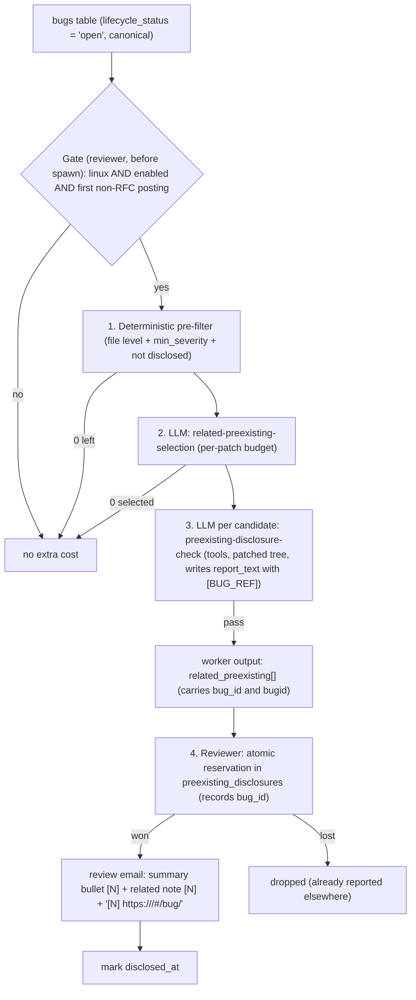

# Design: Report Related Pre-existing Bugs in Patch Reviews

## 1. Goal

Daemon review emails never mention pre-existing bugs.
`queue_notifications` (`src/reviewer.rs`)
filters them out. This feature mentions a pre-existing bug **only when it is clearly worth it**:

| # | Requirement | Mechanism |
|---|---|---|
| R1 | Relevant: same code, or a very similar bug to the one being fixed | Deterministic pre-filter plus an LLM selection stage that has to cite concrete code |
| R2 | First non-RFC posting only; never an RFC, never a later round | Gate computed before the review starts |
| R3 | On by default; can be disabled per mailing list | `report_preexisting_bugs` policy knob |
| R4 | Proportionate | Budget based on patch size, hard cap of 2 |
| R5 | Not security-sensitive, and still present once the patch is applied | Per-candidate **disclosure check** stage, with tools, on the patched tree |
| R6 | Report once; record when and with which patch | New `preexisting_disclosures` table |
| R7 | Configurable severity floor, Medium+ by default | `report_preexisting_bugs` policy knob (`true` = `"medium"`, or `"low"`/`"medium"`/`"high"`/`"critical"`) |

## 2. Relevant current-state facts

1. Pre-existing items found during a patch review (`state.concerns`) are not yet
   verified on mainline or deduplicated until `BugWorker` runs asynchronously.
   Verified, deduplicated pre-existing bugs live in the `bugs` table
   (`lifecycle_status = 'open' AND duplicate_of_id IS NULL`) with a public
   `<project>-<uuid>` identifier (`bugid`), severity, locations, and report.
2. The review email is queued before `BugWorker` finishes processing newly discovered
   concerns from the current patch. Therefore, related pre-existing bug candidates in
   daemon reviews are loaded from the already-verified `Open` bugs in the `bugs` table
   touching the patchset's files, and passed into the review pipeline via `ReviewInput`.
3. Nothing records that a bug was emailed. Reruns delete `reviews` and `bug_reviews` rows.
4. **RFC and lineage:**
   - `parse_subject_version` (`src/patch.rs`) reads `[RFC v3]` as v3 and `[RFC]` as unversioned (so v1).
     The RFC token is not stored.
   - Version lineage links postings by chronology, not version tags. So `[RFC]` → `[PATCH]`,
     `RFC v2` → `PATCH v1`, and resends with an unchanged tag all link to their predecessor
     (`previous_patchset_id`). Late links remain possible.

## 3. Architecture



### 3.1 Gate (R2, R3), computed in reviewer before the worker is spawned
- `eligible = project == linux && policy.enabled && !is_rfc && first_non_rfc_posting`.
  - **First non-RFC posting:** no earlier posting in the `previous_patchset_id` chain is a non-RFC one.
    RFCs never report, so `[RFC]` → `[PATCH]` and `RFC v3` → `PATCH v4` are eligible whatever the tag.
  - **No known predecessor:** the version tag must also be 1, since an unlinked `[PATCH v5]` means earlier rounds exist.
  - A resend (`[PATCH]` → `[PATCH v1]`) follows a non-RFC posting, so it is not eligible.
  The first version is **Linux only**. sashiko, qemu and gcc each have their own workflow builder and report
  stage, and will be follow-ups.
- RFC detection: `patch::is_rfc_subject(subject)` runs on the patchset subject when the gate runs.
  Inside the leading bracketed groups it accepts `RFC` optionally followed by a version (`RFC`, `RFCv2`, `RFC2`).
  Outside them it only accepts an exact leading `RFC` word.
  Nothing is stored: the subject is already persisted, and no other consumer needs an `is_rfc` column yet.
  Forge MRs: the `#N [vK]:` prefix is stripped first, so only an `RFC` prefix in the PR title counts. Draft status is ignored.
- The policy is resolved from the patchset's To/Cc addresses (§3.2).
- The gate is per patchset, so it is passed to `process_patch_review` → `run_review_tool` as its own argument.
  `WorkerSubprocessOverrides` is daemon-wide and is not used for it.
  The worker gets `--related-preexisting-min-severity <sev> --related-preexisting-budget <n>`.
  These become a typed `RelatedPreexistingMode::{Disabled, Enabled { min_severity, budget }}` in the review state (default `Disabled`).
  This mode is separate from the CLI flag `report_preexisting`, which reports everything.
- Verified open canonical bugs (`lifecycle_status = 'open' AND duplicate_of_id IS NULL`)
  and disclosures already recorded in the files the patch touches are passed to the worker
  via `ReviewInput` (`candidate_bugs` and `known_disclosures`). Selection uses them to pick
  from verified database bugs and avoid spending its budget on repeats. The authoritative
  deduplication check is still the reservation (§3.6).

### 3.2 Policy (R3, R7): per mailing list
Per mailing list, at least for now:
- Every existing policy knob lives in `mailing_lists.toml`, and maintainers already onboard through it.
- The resolution rules are proven (`mute_all`, `embargo_hours`).
- MAINTAINERS-section policy would need new plumbing for a hypothetical need. It can be added later
  without breaking the config format.

```toml
[defaults]
report_preexisting_bugs = true   # true ("medium") | false | "none" | "low" | "medium" | "high" | "critical"

["linux-mm@kvack.org"]
report_preexisting_bugs = false
```
- Typed: `RelatedPreexistingPolicy { enabled: bool, min_severity: SeverityFloor }` in defaults, and an
  `Option` of each field per list (`RelatedPreexistingOverride`). `SeverityFloor` has no `Unknown` level.
  The legacy `[defaults.related_preexisting]` / `["<list>".related_preexisting]` table form remains accepted as a `serde` alias.
- Resolution across matched lists: any `enabled = false` ⇒ off. The effective `min_severity` is the
  **strictest** (highest) of the explicit values, otherwise the default. If no list matched, the defaults apply.

### 3.3 Step 1: deterministic pre-filter (no LLM, file and symbol level)
During the workflow, concern locations are raw LLM output: lines and sides are unverified, because grounding
runs after the workflow. So the pre-filter only checks facts it can trust:
- `severity >= min_severity` (or `Medium` when `min_severity == High` and one of the candidate's locations in a
  surviving touched file names a function or symbol present in that file's diff hunks).
- At least one location is in a file the patch touches, and that file still exists after the patch
  (a deleted file is never reported).
- The candidate is not a duplicate (same rule as §3.6) of a disclosure the reviewer passed in.

Line proximity and "the patch removes or rewrites these lines" are left to steps 2 and 3, which have the diff
and tools. The pre-filter is a pure function of the state, recomputed wherever it is needed
(skip predicate, prompt variable, validator). The workflow engine has no deterministic transform step.

### 3.4 Step 2: LLM `related-preexisting-selection` (R1, R4)
- Inputs: the commit message, the diff, the new findings, the pre-filtered candidates, and the budget.
- Outputs: `selected[]` with `relation: SameCode | SamePattern | Other` and cited code, plus `dismissed_concerns[]`.
  - `SameCode`: anywhere in a function or code block the patch modifies (or its direct helper in the same file).
  - `SamePattern`: the same kind of defect (mistake, API misuse, missing check or lock) in the same file.
  - `Other`: affects the same data structure, lock, resource lifecycle, or paired operation (`init`/`destroy`,
    `register`/`unregister`, `attach`/`detach`, `get`/`set`, `open`/`close`) in the same file.
- Anti-charity: select a candidate only when one of these concrete connections holds and can be cited.
- Validator: `len(selected) <= budget`, each item refers to a candidate id from the pre-filter, and any selected
  candidate whose severity is below `min_severity` (such as `Medium` under a `High` floor) must use `relation == SameCode`.
- Budget is **per patch**: patches changing ≤ 30 lines get 1, larger patches get 2. There is no series-wide cap.
  "Never twice" is guaranteed by §3.6, not by the budget.

### 3.5 Step 3: LLM `preexisting-disclosure-check`, one per candidate, in parallel (R5)
This is a separate, tool-enabled review of each selected bug. It runs on the **patched** worktree
(`HEAD` = the reviewed patch), with the pre-image available as `HEAD^`.

Output schema:
```json
{
  "security_sensitivity": "NotSecuritySensitive | SecuritySensitive | Unknown",
  "security_reasoning": "...",
  "post_patch_status": "StillPresent | RemovedByPatch | FixedByPatch | MovedOrChanged | Unknown",
  "post_patch_evidence": "file:line + quoted post-image code",
  "decision": "Report | Drop",
  "drop_reason": "..."
}
```
- The candidate is reported **only** if it is `NotSecuritySensitive` **and** `StillPresent`.
  `Unknown` on either field means it is dropped (fail-closed).
- Security-sensitive follows the Linux kernel security policy and threat model
  (`Documentation/process/threat-model.rst`, loaded from the mainline ref at run time when
  available): a bug plausibly exploitable across a guaranteed kernel security boundary (an
  unprivileged local user or unprivileged user namespace, a remote network peer, a virtualization
  guest crossing a guest-to-host/hypervisor boundary, or untrusted hardware on an IOMMU/driver path
  explicitly documented as hardened against hostile peripherals) to gain memory corruption,
  privilege escalation, a leak across a privilege boundary, or remote/guest-to-host denial of
  service. Classes excluded by `threat-model.rst`—bugs requiring root or elevated capabilities
  (`CAP_SYS_ADMIN`, `CAP_NET_ADMIN`, etc.), `debugfs`/staging/experimental Kconfigs,
  administrator-mounted crafted filesystem images (unless `FS_USERNS_MOUNT` allows unprivileged
  userns mounts), non-conforming/emulated hardware outside explicitly hardened paths, local
  non-exploitable denial of service (leaks, hangs, `WARN`s, clean NULL-pointer oopses), races
  without an attacker-controlled trigger, and functional bugs—are not security-sensitive and may be
  reported. The prompt text of both the selection and the check stages lives in
  `src/workflows/related_preexisting.rs` as constants, with `<kernel_threat_model>` injected from
  `LinuxPatchReviewState`.
- `StillPresent` requires quoting the defective code **from the post-image**.
  If the patch deletes or rewrites it, the result is `RemovedByPatch`/`FixedByPatch`, and the candidate is dropped.
- Validator: `decision == Report` is only accepted when `post_patch_evidence` is filled in.
- Items that pass are kept in `related_preexisting[]` (preserving `bug_id` and `bugid`) and passed into the
  `report` stage alongside `findings` with `"preexisting": true` and indexed `"bug_ref"` placeholders
  (`"[BUG_REF]"`, `"[BUG_REF:2]"`), so the `report` stage formats them inline under their diff hunks in a single pass.
- Dropped candidates are logged as `dismissed_concerns`.

### 3.6 Step 4: reservation and reporting (R6: never twice)
When the worker returns, the reviewer reserves each `related_preexisting` item in one `BEGIN IMMEDIATE` transaction.
Concurrent reviews, including other patches of the same series, are serialized by SQLite's write lock.
- For each item, load the disclosures recorded in the same files, excluding only rows for **this patch's own
  Message-ID** (from a rerun). Other patches of the same series count.
- The item is a **duplicate** if any loaded disclosure has the same `bug_id`, the same fingerprint, shares a file
  **and** a function/symbol with it, or reaches lexical vector similarity ≥ 0.5 in the same file.
  This is deliberately aggressive: two different bugs in one function means only the first is ever mentioned.
- Non-duplicates are inserted as **reserved** rows (`disclosed_at` NULL, with `bug_id` set from the candidate)
  in the same transaction. Duplicates are dropped, logged, and pruned from `review_inline` / `inline_review` by
  `retain_reserved_disclosures`.
- Email and Web UI:
  - Each reserved disclosure with a `bugid` (`<project>-<uuid>`) is assigned a sequential footnote number `[N]`
    continuing after any `[1]..[k]` footnote definitions at the bottom of `inline_review`.
  - The top summary bullet renders `- [<Severity>] <problem> [N]`.
  - `compose_inline_review_with_related` replaces each `[BUG_REF]` / `[BUG_REF:N]` placeholder in `inline_review`
    with its `[N]` footnote number so both `reviews.inline_review` (shown in the Web UI card) and the outbound email
    body display the related bug inline under its diff hunk.
  - All `[N] <url>` footnote definitions (both prior-discussion links from `inline_review` and
    `[N] https://<domain>/#/bug/<bugid>` links for the related pre-existing bugs) are emitted together at the
    very bottom of the review body, immediately above the `-- ` signature.
  - It sets `disclosed_at` when the email is queued. Embargo release re-renders from the same rows, keyed by the patch Message-ID.
  - If routing mutes or skips the email, or the outbox does not queue it, or the email is disabled or a dry run,
    the patch's reserved rows are deleted so they don't block a later review.
  - A reservation that is never mailed (cancelled patchset, failed sibling patch, crash) **expires after 14 days**.
    After that it neither blocks other reviews nor gets mailed. This avoids chasing every abandonment path.
  - The reservation is made **before** the review is marked complete. A crash in between then cannot skip
    straight to the idempotent re-queue path and lose the related bugs.
  - **Embargo:** an unmailed reservation counts like a finding in the clean-patchset check.
    So an embargoed patchset whose only output is a related bug waits for the embargo instead of being released early.
- **Zero new findings:** a patch with no new findings but a reserved related bug gets a normal review email
  (routed like one with findings, still subject to `mute_all`). The header says it found no new issues
  but noticed a related pre-existing one. The `positive_review` policy does not apply.
- Related items do not affect the exit code, patchwork state, or finding counts.

### 3.7 Recording
Migration `019_preexisting_disclosures.sql` adds two tables:
- `preexisting_disclosures`, with columns `patch_message_id`, `fingerprint`, `problem`, `severity`, `relation`,
  `locations_json`, `vector_json`, `report_text`, `reserved_at`, nullable `disclosed_at`, and nullable `bug_id`.
  Rows are unique on `(patch_message_id, fingerprint)`.
- `preexisting_disclosure_files(disclosure_id, file)`, indexed by `file`, so duplicate checks never scan the whole table.

How rows are keyed and maintained:
- Rows are keyed by the reviewed patch's **Message-ID**, not by patch, patchset, review or outbox ids.
  Patchset merges, reruns and embargo re-queues delete or rewrite those rows; the Message-ID never changes.
  `bug_id` is the only foreign key, and bugs are never deleted.
- A rerun of the same patch replaces its own reserved rows. Disclosed rows are kept, with their original `disclosed_at`.
- BugWorker backfills `bug_id` (for new bugs and duplicates) by matching the review's patch Message-ID and the fingerprint.
  The bug page then shows "Reported in <msgid> on <date>".

### 3.8 Local review (`sashiko review`)
- New flag: `--report-related-preexisting [--related-preexisting-min-severity <sev>]`.
  It conflicts with `--report-preexisting`, which reports every verified pre-existing bug (clap `conflicts_with`).
- The flag is the gate. Local review has no database, lineage or mailing-list policy, so no version, RFC or policy checks run.
  The user explicitly asked for this mode.
- Steps 1–3 (pre-filter, selection with budget, disclosure check) run the same as in the daemon.
  The "already disclosed" part of the pre-filter is skipped because there are no disclosure records.
- Output: passing items are printed under a `Related Pre-existing Findings:` section.
  Like the existing pre-existing output, they do not affect the exit code.

## 4. Risks
- **Cost:** in the common case, zero. In the worst case, 1 selection call plus up to 2 short tool sessions per patch, and only on eligible v1 patches.
- **False negatives from fail-closed:** these are acceptable by design ("only if really worth it").
- **Late lineage linking:** a patch may wrongly count as a first version, so at worst one extra mention on a resend.

## 5. Resolved decisions
- Option A: selection happens inside the review pipeline.
- All RFCs are excluded. Forge PRs count as RFC only with an `RFC` title prefix.
- The policy is per mailing list, with `min_severity` configurable (default High).
- Each candidate gets a separate disclosure check: not security-sensitive, and still present after the patch. Unknown means drop.
- Only the first non-RFC posting of a series is eligible (lineage links by chronology, RFCs included).
- Linux only in the first version.
- Budget is per patch, with no series cap. Atomic reservation guarantees a bug is never reported twice.
- A patch with zero new findings still gets an email for a related bug.
- The pre-filter works at file level.
- Local review gets its own `--report-related-preexisting` flag.

## 6. Implementation plan (one commit each)
1. Add this design to `designs/`.
2. `is_rfc_subject` + tests.
3. `RelatedPreexistingPolicy` in `email_policy.rs`, resolution + tests, `mailing_lists.toml`/docs.
4. `preexisting_disclosures` migration + DB methods (atomic reservation, disclosure marking, bug link) + tests.
5. Gate in reviewer + typed `RelatedPreexistingMode` plumbing to the worker.
6. Pre-filter (pure function + unit tests).
7. Selection stage + validator + prompt + tests.
8. Disclosure-check stage + validator + prompt + tests.
9. Reviewer reservation with the duplicate rule + email section and zero-findings email + `disclosed_at` + BugWorker `bug_id` backfill.
10. Local `--report-related-preexisting` flag + CLI rendering.
11. Docs + a `benchmark_preexisting.json` case covering "patch deletes the file".
