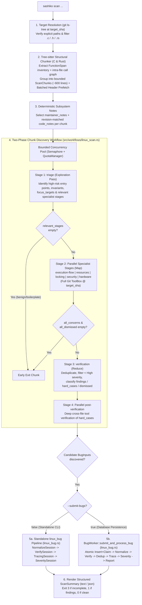

# Design: `sashiko scan` — Active Linux Kernel Codebase Scanner

## Status
Proposed

## 1. Overview & Motivation

Sashiko's existing review pipeline (`sashiko review` and the daemon `Reviewer`) is diff-driven: it inspects proposed patches and only uncovers pre-existing defects when they happen to lie in the immediate context of a modified hunk. Meanwhile, the vast majority of the Linux kernel codebase—device drivers, filesystems, networking protocols, IPC, and memory management subsystems—contains latent **High** and **Critical** bugs (use-after-free, double free, out-of-bounds memory access, race conditions, deadlocks, sleeping in atomic context, integer overflows, and reference count leaks) in code that has not been touched by recent patches.

This document specifies `sashiko scan`, a command that actively scans specified files and directories in the Linux kernel repository (`--project linux`) for serious (`High` and `Critical`) defects using a **two-phase map-reduce chunk discovery workflow** (`src/workflows/linux_scan.rs`) tightly integrated with Sashiko's **Linux Bug Pipeline** (`src/workflows/linux_bug.rs`).

### 1.1 Goals
1. **Path-Scoped Active Scanning**: Accept one or more file or directory paths (e.g., `sashiko scan fs/smb/server/` or `sashiko scan drivers/nvme/host/core.c`) and resolve all target source files (`.c`, `.h`, `.rs`) at a pinned Git revision (`--ref`, defaulting to mainline top-of-trunk or `HEAD`).
2. **Structure-Aware Chunking**: Partition large kernel source files into coherent, bounded function clusters using `tree-sitter-c` (with a comment/literal-aware brace-depth scanner for `.rs`) so the LLM never suffers attention dilution on 5,000+ line files while keeping related intra-file callers/callees (e.g., `alloc`/`free`, `probe`/`remove`, `lock`/`unlock`) together, and batch external header symbol lookups once per file (`prefetch_external_definitions_for_chunks`).
3. **Two-Phase Map-Reduce Chunk Discovery (`src/workflows/linux_scan.rs`)**:
   - **Deterministic Subsystem Context**: Load applicable `maintainer_notes` (`projects/linux/prompts/maintainers/*.md`) and revision-matched `code_notes` (`projects/linux/prompts/notes/`) deterministically from each chunk's file path and source identifiers, framing `<code_notes>` strictly as reference background subordinate to the live code at `target_sha`.
   - **Phase 1 (Exploration & Triage)**: Run an exploration pass (`triage`) over each chunk's function inventory and source code to identify high-risk entry points, state invariants, `focus_targets`, and relevant specialist stages (short-circuiting benign boilerplate chunks early).
   - **Phase 2 (Parallel Specialist Map + Verification Reduce)**: Fan out to specialist stages (`execution-flow`, `resources`, `locking`, `security`, `hardware`) with full Git `ToolBox` access, Negative Data Tracking (`dismissed_concerns`), and Anti-Charity directives; consolidate and verify in `verification` and parallel `post-verification` to emit high-confidence candidate `BugInput` (`src/api.rs`) records.
4. **First-Class Integration with the `linux_bug` Pipeline (`src/workflows/linux_bug.rs`)**:
   - Instead of duplicating normalization, origin commit tracing, or patch-review LKML email formatting inside `linux_scan.rs`, every candidate `BugInput` discovered across chunks is processed through the canonical `linux_bug` pipeline:
     - **Standalone CLI Mode (default)**: Runs `run_standalone_bug_pipeline_for_project` (`NormalizeSession` -> `VerifySession` -> `TracingSession` + `deterministic_blame_fallback` -> `SeveritySession` at `target_sha`), filtering out false positives and `< High` issues and returning structured `ScannedBug` findings (`canonical_title`, `canonical_description`, `severity`, `severity_explanation`, `subsystems`, `source_files`, `locations`, `introduced_in_commit`, `verified_on_sha`).
     - **Bug Repository Submission Mode (`--submit-bugs`)**: Atomically inserts and claims each candidate bug (`create_claimed_issue_for_project` / `BugWorker::submit_and_process_bug`) and executes `process_issue_worker_for_project` against mainline (`NormalizeSession` -> `VerifySession` -> `DedupSession` under `BUG_DEDUP_LOCK` + cross-process `bug_dedup_lease` -> `TracingSession` -> `SeveritySession` -> `ReportSession` -> `db.update_bug_outcome`).
5. **Serious Issues Only & Honest Exit Semantics**: Strictly target reachable `High` and `Critical` bugs, discarding stylistic, theoretical, or `Low`/`Medium` concerns. Any chunk failure (`chunks_failed > 0`) or candidate verification/submission failure (`candidates_failed > 0`) marks the scan incomplete, suppresses clean-scan confirmation, and exits with status `3` (matching `sashiko review`), while verified findings on a complete scan exit with status `1`.

---

## 2. CLI Interface

`sashiko scan` is added as a subcommand in `Commands` (`src/main.rs`) and currently supports `--project linux` (rejecting non-Linux `--project` values upfront):

```text
sashiko scan [OPTIONS] <PATHS>...
```

### 2.1 Arguments & Flags

| Flag / Argument | Type | Default | Description |
| :--- | :--- | :--- | :--- |
| `<PATHS>...` | `Vec<PathBuf>` | *(required)* | One or more repository-relative file or directory paths to scan (e.g., `fs/smb/server/`, `net/sched/sch_api.c`). |
| `--ref <REV>` | `Option<String>` | Mainline / `HEAD` | Git revision to scan (`--rev` alias supported). All file reads and chunk `ToolBox` calls are pinned to this exact commit SHA. |
| `-r, --repo <PATH>` | `Option<PathBuf>` | Current git worktree / `settings.git.repository_path` | Path to the target Git repository. |
| `--settings <PATH>` | `Option<PathBuf>` | `Settings.toml` | Path to the settings file. |
| `--concurrency <N>` | `usize` | `4` | Maximum number of scan chunks evaluated concurrently. |
| `--max-files <N>` | `usize` | `200` | Safety cap on the number of source files expanded from `<PATHS>...` in one run (`0` = unlimited). |
| `--max-chunks <N>` | `Option<usize>` | `None` | Optional cap on the total number of chunks scanned (`0` = unlimited). |
| `--exclude <PATTERN>` | `Vec<String>` | `[]` | Exclude files matching a substring or prefix pattern (may be repeated). |
| `--submit-bugs` | `bool` | `false` | Submit verified `High`/`Critical` findings into the configured bug database (`bugs`) and run deduplication and persistence. |
| `--custom-prompt <TEXT>` | `Option<String>` | `None` | Extra instructions appended to the scan system prompt. |
| `--ai-provider <NAME>` | `Option<String>` | `settings.ai.provider` | AI provider override. |
| `-m, --model <MODEL>` | `Option<String>` | `settings.ai.model` | AI model override. |
| `--effort <MODE>` | `Option<EffortMode>` | `settings.effective_effort()` | Reasoning effort mode override (`mid`, `high`, or `dynamic`). |
| `--prompts <PATH>` | `Option<PathBuf>` | Project prompt bundle | Override prompt directory (`projects/linux/prompts`). |
| `--format <FMT>` | `OutputFormat` | `text` | Output format (`text` or `json`). |
| `--color <MODE>` | `ColorMode` | `auto` | Terminal color mode (`auto`, `always`, `never`). |

---

## 3. Architecture & Data Flow



---

## 4. Detailed Component Design

### 4.1 Target File Resolution & Filtering (`src/scan.rs`)

1. **Revision Resolution**:
   - If `--ref` is provided, resolve it to a full commit SHA via `git -c safe.bareRepository=all rev-parse --verify --quiet --end-of-options <rev>^{commit}` using `git_cmd::in_dir_async`.
   - If `--ref` is omitted, resolve mainline top-of-trunk (`resolve_linus_sha`) or `HEAD` (falling back to `origin/master`, `origin/main`, `master`, or `main` for bare repositories).
2. **Path Enumeration**:
   - Sanitize each user-supplied path via `sanitize_scan_path` (rejecting leading `-`, absolute paths, control characters, or `..` traversal), verify every explicit target path exists in the tree at `target_sha`, and invoke:
     ```text
     git -c safe.bareRepository=all ls-tree -r -z --name-only <target_sha> [-- <paths...>]
     ```
     (omitting pathspecs when `.` is among the targets so the whole tree is enumerated).
   - Retain files ending in `.c`, `.h`, or `.rs`.
   - Exclude paths matching default noisy non-production patterns (`Documentation/*`, `samples/*`, `scripts/*`, `tools/testing/selftests/*`, `LICENSES/*`, `*.mod.c`) and user `--exclude` patterns, unless the user explicitly targeted that path.
   - Enforce `--max-files` (default `200`).

### 4.2 Tree-sitter Structural Indexing & Batched Prefetch (`src/scan.rs`, `src/worker/prefetch.rs`)

`src/scan.rs` implements a deterministic structure-aware chunker built on `tree-sitter-c` (with a comment/literal-aware brace-depth scanner for `.rs`):

```rust
#[derive(Debug, Clone, Serialize, Deserialize, PartialEq, Eq)]
pub struct FunctionSpan {
    pub name: String,
    pub signature: String,
    pub start_line: usize, // 1-based inclusive
    pub end_line: usize,   // 1-based inclusive
    pub called_functions: Vec<String>,
    pub risk_signals: Vec<String>,
}

#[derive(Debug, Clone, PartialEq, Eq)]
pub struct ScanChunk {
    pub file_path: String,
    pub chunk_index: usize,
    pub total_chunks: usize,
    pub start_line: usize,
    pub end_line: usize,
    pub numbered_source: String,
    pub file_function_index: String,
    pub functions: Vec<FunctionSpan>,
    pub prefetched_headers: String,
}
```

For `.c` and `.h` files, `prefetch_external_definitions_for_chunks` in `src/worker/prefetch.rs` reuses a single `SourceSnapshot` and batches `git grep` across the union of external symbols referenced by all retained chunks of the file before rendering per-chunk definition blocks within `MAX_HEADER_PREFETCH_CHARS`.

### 4.3 Two-Phase Chunk Discovery Workflow (`src/workflows/linux_scan.rs`)

The chunk discovery workflow is implemented as a declarative `Workflow<LinuxScanState>` (`src/workflow/graph.rs`) in `src/workflows/linux_scan.rs`:

1. **Deterministic Subsystem & Code Notes (`src/scan.rs`)**:
   - Loads `maintainer_notes` once per scan (`load_maintainer_notes`) and selects the revision-appropriate `code_notes` set (`load_sets` + `choose_set` at `target_sha`).
   - Renders per-chunk `<maintainer_notes>` and `<code_notes>` from the chunk's file path and source identifiers, framing `<code_notes>` as subordinate to the live code at `target_sha`.
2. **Phase 1, Stage 1: `triage` (`ToolScope::None`, `max_turns: 1`)**:
   - Audits the chunk's `numbered_source` and `chunk_functions_json` to emit `focus_targets` (`Vec<ScanFocusTarget>`) and `relevant_stages` (`Vec<String>`).
   - If `relevant_stages` is empty (benign definitions/boilerplate), Phase 2 is skipped.
3. **Phase 2, Stage 2: Parallel Specialist Audit Stages (`WorkflowStep::DynamicParallel`)**:
   - Runs the selected stages from `["execution-flow", "resources", "locking", "security", "hardware"]` (loading `callstack.md` for `execution-flow` and `locking.md` for `locking`) with `ToolScope::All`, Anti-Charity directives, and Negative Data Tracking (`dismissed_concerns`).
4. **Phase 2, Stage 3 & Stage 4: `verification` and Parallel `post-verification`**:
   - Consolidates `all_concerns` and `all_dismissed_concerns`, filters out findings below `High` severity, validates snapshot `locations` via `has_valid_scan_proof_location`, and verifies contested or cross-file `hard_cases` using Git tools.
   - Confirmed findings are converted into standard `BugInput` payloads (`LinuxScanState::to_candidate_bug_inputs`).

### 4.4 Integration with `linux_bug` (`src/workflows/linux_bug.rs`, `src/worker/bug_worker.rs`, `src/scan.rs`)

1. **Intra-Scan Candidate Deduplication**:
   - Before invoking `linux_bug`, `run_scan` deduplicates candidate `BugInput`s across chunks by `(file, function_or_symbol, line_bucket)` and sparse-vector cosine similarity ($\ge 0.85$).
2. **Standalone `linux_bug` Pipeline (`run_standalone_bug_pipeline_for_project`)**:
   - When `--submit-bugs` is not enabled, `run_scan` runs each candidate `BugInput` through `run_standalone_bug_pipeline_for_project` in `src/workflows/linux_bug.rs`:
     1. `NormalizeSession`: normalizes the candidate into `canonical_title` (`<subsystem_prefix>: <defect in fn()>`, `< 80` chars, no fix-verbs), structured `canonical_description` (`Trigger / Preconditions`, `Call Chain`, `Failure Mechanism`, `Impact`), and `affected_source_files`.
     2. `VerifySession`: verifies reachability and call chains against the repository at `target_sha` using `ToolBox` and pre-fetched context, discarding false positives (`StandaloneBugOutcome::Discarded`).
     3. `TracingSession` (+ `deterministic_blame_fallback` + `format_commit`): traces `introduced_in_commit`.
     4. `SeveritySession`: calibrates `severity` and `severity_explanation` (filtering out `< High` findings).
3. **Database Submission Mode (`--submit-bugs`, `BugWorker::submit_and_process_bug`)**:
   - Validates upfront at the start of `run_scan` that `settings.database.url` is non-empty and opens/migrates `Database` before scanning any chunks.
   - For each candidate `BugInput`, `BugWorker::submit_and_process_bug` atomically inserts and claims the bug row in a single SQLite transaction (`Database::create_claimed_bug_with_enrichment` / `create_claimed_issue_for_project`) so no concurrent daemon `BugWorker` can steal the pending row, and runs `process_issue_worker_for_project` against mainline (serializing deduplication via `BUG_DEDUP_LOCK` and the cross-process `Database::acquire_bug_dedup_lease` in `meta`).

---

## 5. Implementation Plan

1. **Commit 1 — Design Document (`designs/DESIGN_SCAN_COMMAND.md`)**:
   - Specify the architecture, chunker, two-phase discovery workflow, and `linux_bug` pipeline integration.
2. **Commit 2 — Target File Resolution & Tree-sitter Chunker (`src/scan.rs`, `src/worker/prefetch.rs`, `src/lib.rs`)**:
   - Implement `resolve_scan_targets`, `sanitize_scan_path`, `extract_c_functions`, `extract_rust_functions`, `build_scan_chunks_for_file`, and batched per-file header context prefetching (`prefetch_external_definitions_for_chunks`).
3. **Commit 3 — Declarative Two-Phase Discovery Workflow (`src/workflows/linux_scan.rs`, `src/workflows/mod.rs`)**:
   - Implement `LinuxScanState`, `scan_triage_stage`, specialist audit stages, `scan_verification_stage`, `scan_post_verification_stage`, and `to_candidate_bug_inputs`.
4. **Commit 4 — Scan Runner & `linux_bug` Pipeline Integration (`src/db.rs`, `src/git_ops.rs`, `src/maintainers.rs`, `src/notes/`, `src/workflows/mod.rs`, `src/workflows/linux_bug.rs`, `src/worker/bug_worker.rs`, `src/scan.rs`, `GEMINI.md`)**:
   - Expose `linux_bug` unconditionally in `src/workflows/mod.rs` and add `run_standalone_bug_pipeline_for_project` in `src/workflows/linux_bug.rs`.
   - Add `Database::create_claimed_bug_with_enrichment`, `acquire_bug_dedup_lease`, `renew_bug_dedup_lease`, `release_bug_dedup_lease`, and `BugWorker::submit_and_process_bug`.
   - Implement `run_scan` in `src/scan.rs` with `QuotaManager` rate limiting, deterministic notes selection, and `candidates_failed` tracking.
5. **Commit 5 — `sashiko scan` CLI Subcommand & Documentation (`src/main.rs`, `docs/sashiko-cli.md`)**:
   - Add `Commands::Scan`, `handle_scan_command`, `write_scan_result`, `scan_exit_code`, CLI tests, and documentation.
